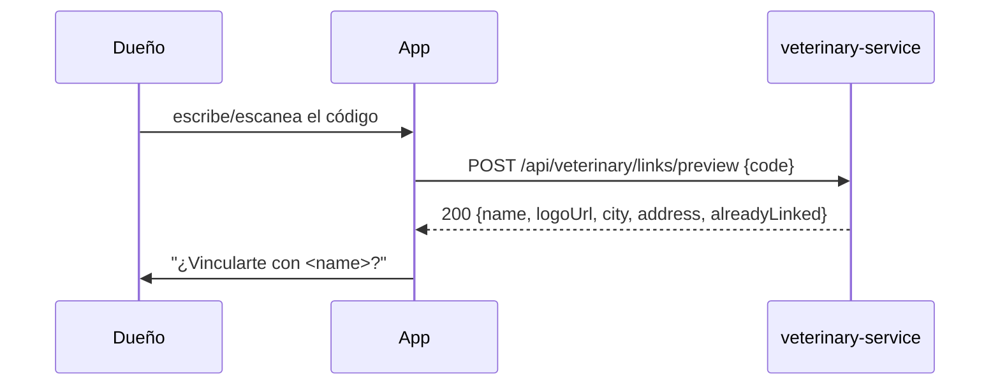
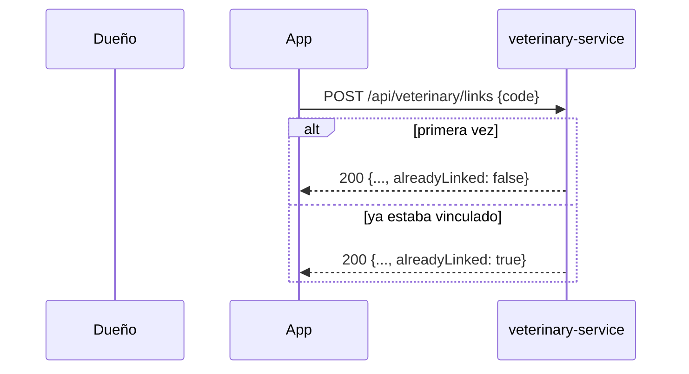
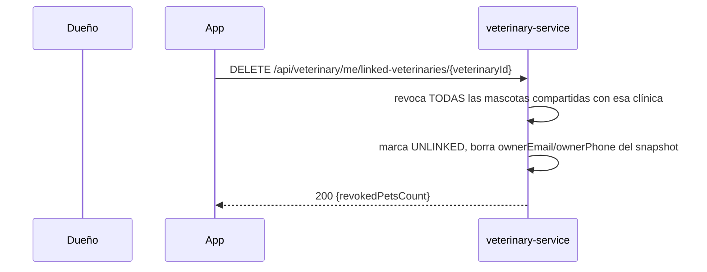
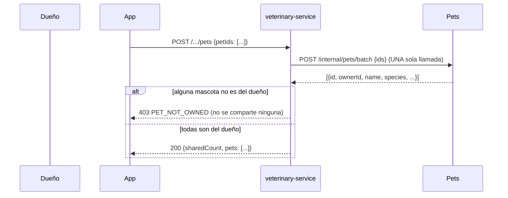

# Fase 4A — Vinculación, mascotas compartidas y pacientes

Guía para el frontend (app de dueños y web de clínicas) de todo lo que agregó la Fase 4A:
vincularse a una clínica con un código, compartir/revocar mascotas, y el lado de la clínica
(clientes y pacientes). Sacada del código real — DTOs, controllers, `GlobalExceptionHandler`.

Esta Fase **no** incluye mascotas registradas por la clínica sin cuenta del dueño ("walk-in"),
reclamo de esas mascotas, ni el acceso de clínicas dentro de Pets (PETS-03) — eso es Fase 4B.

Los dos endpoints internos que consume Medical (`access`/`summary`) están documentados aparte en
[`docs/integracion/VETERINARY_REQUERIMIENTOS_DESDE_MEDICAL.md`](./integracion/VETERINARY_REQUERIMIENTOS_DESDE_MEDICAL.md) —
esta guía es para el frontend, no para otros servicios.

## Índice

1. [Aviso de datos personales (Ley 1581 de 2012)](#1-aviso-de-datos-personales-ley-1581-de-2012)
2. [Flujo: vista previa por código](#2-flujo-vista-previa-por-código)
3. [Flujo: vincularse (idempotente)](#3-flujo-vincularse-idempotente)
4. [Flujo: mis clínicas vinculadas](#4-flujo-mis-clínicas-vinculadas)
5. [Flujo: desvincularse](#5-flujo-desvincularse)
6. [Flujo: compartir mascotas](#6-flujo-compartir-mascotas)
7. [Flujo: revocar una mascota](#7-flujo-revocar-una-mascota)
8. [Flujo: con qué clínicas comparto una mascota](#8-flujo-con-qué-clínicas-comparto-una-mascota)
9. [Lado clínica: código de vinculación](#9-lado-clínica-código-de-vinculación)
10. [Lado clínica: clientes](#10-lado-clínica-clientes)
11. [Lado clínica: pacientes](#11-lado-clínica-pacientes)
12. [Lado clínica: quitar un cliente](#12-lado-clínica-quitar-un-cliente)
13. [Rutas deprecadas](#13-rutas-deprecadas)
14. [Nota técnica: `uq_user_veterinary_link`](#14-nota-técnica-uq_user_veterinary_link)

---

## 1. Aviso de datos personales (Ley 1581 de 2012)

**Antes de que el dueño confirme la vinculación**, la pantalla tiene que decirle explícitamente:

> Al vincularte con esta clínica, vas a compartir tu **nombre**, **correo** y **teléfono** con su
> personal. Si te desvinculás, la clínica deja de ver tu correo y tu teléfono (conserva solo tu
> nombre, para que su historial siga siendo legible).

Estar vinculado **no** le da a la clínica acceso a ninguna mascota por sí solo — eso es un paso
aparte y explícito (sección 6). El consentimiento de datos del dueño (correo/teléfono) y el
consentimiento clínico (ver la historia de una mascota) son dos cosas distintas.

Nota de implementación: hoy el teléfono (`ownerPhone`) **siempre viaja `null`** porque el contrato
interno del User service no lo expone todavía — ver la nota en `CLAUDE.md` ("Pendientes del lado
del User service"). El aviso sigue siendo correcto igual: en cuanto User lo exponga, empieza a
llenarse sin que la clínica tenga que hacer nada.

---

## 2. Flujo: vista previa por código



**`POST /api/veterinary/links/preview`** — token **normal**.

El código va en el **cuerpo**, nunca en la URL (el gateway y Cloud Run loguean la URL completa).

```json
// Request
{ "code": "7K2M9XQ4" }

// 200 OK
{
  "veterinaryId": "9a1c2f3e-4b5d-6e7f-8a9b-0c1d2e3f4a5b",
  "name": "Clínica Veterinaria El Bosque",
  "logoUrl": "https://cdn.example.com/logo.png",
  "city": "Bogotá",
  "department": "Bogotá D.C.",
  "address": "Calle 1 # 2-3",
  "alreadyLinked": false
}
```

Solo datos públicos — nada interno (sin NIT, razón social, estado, contacto). Cualquiera con un
código puede llamar esto.

| `code` | HTTP | Cuándo |
|---|---|---|
| `INVALID_INVITE_CODE` | 400 | Falta el código o está vacío. |
| `LINK_CODE_NOT_FOUND` | 404 | El código no existe **o** la clínica no está `ACTIVE`. Mismo error para los dos casos a propósito: distinguirlos permitiría ir probando códigos para enumerar qué clínicas existen y en qué estado están. |

---

## 3. Flujo: vincularse (idempotente)



**`POST /api/veterinary/links`** — token **normal**.

```json
// Request
{ "code": "7K2M9XQ4" }

// 200 OK (vinculación nueva)
{
  "id": "44dd55ee-66ff-4007-8118-223344556677",
  "veterinaryId": "9a1c2f3e-4b5d-6e7f-8a9b-0c1d2e3f4a5b",
  "veterinaryName": "Clínica Veterinaria El Bosque",
  "logoUrl": "https://cdn.example.com/logo.png",
  "status": "LINKED",
  "linkedAt": "2026-11-08T14:00:00",
  "alreadyLinked": false
}

// 200 OK (ya estaba vinculado — no es un error)
{
  "id": "44dd55ee-66ff-4007-8118-223344556677",
  "veterinaryId": "9a1c2f3e-4b5d-6e7f-8a9b-0c1d2e3f4a5b",
  "veterinaryName": "Clínica Veterinaria El Bosque",
  "status": "LINKED",
  "linkedAt": "2026-10-01T09:00:00",
  "alreadyLinked": true
}
```

**Siempre responde `200`**, nunca `409`, incluso si ya estabas vinculado: la operación es
idempotente, así que un doble tap o un reintento del frontend ante una respuesta perdida no debería
verse como un error. Usá `alreadyLinked` para decidir qué mensaje mostrar, no el código HTTP.

Si te habías desvinculado antes, vincularte de nuevo **reactiva la misma fila** (mismo `id`): no se
pierde el historial, y el snapshot de contacto (correo) se vuelve a llenar.

| `code` | HTTP | Cuándo |
|---|---|---|
| `INVALID_INVITE_CODE` | 400 | Falta el código. |
| `LINK_CODE_NOT_FOUND` | 404 | Código inexistente o clínica no `ACTIVE`. |

---

## 4. Flujo: mis clínicas vinculadas

**`GET /api/veterinary/me/linked-veterinaries`** — token **normal**.

```json
// 200 OK
{
  "veterinaries": [
    {
      "veterinaryId": "9a1c2f3e-4b5d-6e7f-8a9b-0c1d2e3f4a5b",
      "name": "Clínica Veterinaria El Bosque",
      "logoUrl": "https://cdn.example.com/logo.png",
      "city": "Bogotá",
      "phone": "+573001234567",
      "status": "ACTIVE",
      "linkedAt": "2026-10-01T09:00:00",
      "sharedPetsCount": 2
    }
  ]
}
```

`status` puede ser `SUSPENDED`: el dueño sigue viéndola en la lista (para poder desvincularse o
saber qué pasó), pero la clínica no puede atenderlo mientras dure. `sharedPetsCount` puede ser `0` —
estar vinculado no comparte ninguna mascota por sí solo.

Sin errores propios de este endpoint (token inválido → `401` como cualquier otro).

---

## 5. Flujo: desvincularse



**`DELETE /api/veterinary/me/linked-veterinaries/{veterinaryId}`** — token **normal**.

```json
// 200 OK
{
  "userId": "aa11bb22-cc33-4dd4-8ee5-ff6677889900",
  "veterinaryId": "9a1c2f3e-4b5d-6e7f-8a9b-0c1d2e3f4a5b",
  "revokedPetsCount": 2,
  "message": "User unlinked successfully"
}
```

**Avisale al dueño con `revokedPetsCount`**: es la consecuencia menos obvia de desvincularse ("2
mascotas dejaron de ser visibles para esta clínica").

Todo pasa en una sola transacción: revocar las mascotas, marcar la vinculación `UNLINKED` (nunca se
borra la fila) y limpiar el contacto del snapshot (sección 1).

| `code` | HTTP | Cuándo |
|---|---|---|
| `USER_NOT_LINKED` | 404 | No había vinculación activa con esa clínica. |
| `VETERINARY_NOT_FOUND` | 404 | La clínica no existe. |

---

## 6. Flujo: compartir mascotas



**`POST /api/veterinary/me/linked-veterinaries/{veterinaryId}/pets`** — token **normal**.

```json
// Request
{ "petIds": ["bb22cc33-dd44-4ee5-8ff6-778899001122"] }

// 200 OK
{
  "veterinaryId": "9a1c2f3e-4b5d-6e7f-8a9b-0c1d2e3f4a5b",
  "veterinaryName": "Clínica Veterinaria El Bosque",
  "sharedCount": 1,
  "pets": [
    {
      "petId": "bb22cc33-dd44-4ee5-8ff6-778899001122",
      "petName": "Max",
      "species": "DOG",
      "grantedAt": "2026-11-08T14:10:00",
      "alreadyShared": false
    }
  ]
}
```

Reglas clave:

- **Todo o nada.** Si alguna de las mascotas pedidas no es tuya (o no existe — mismo error para los
  dos casos), no se comparte **ninguna**. Mostrale al dueño exactamente cuáles fallaron antes de
  reintentar con las que sí son suyas.
- **Solo el dueño comparte.** Un EDITOR o VIEWER de la mascota en Pets (roles de compartir entre
  personas) nunca puede dar acceso a una clínica — eso es decisión exclusiva del dueño.
  `sharedCount` solo cuenta las que se compartieron **en esta llamada**; una mascota ya compartida
  vuelve con `alreadyShared: true` y no suma al contador (es idempotente, no un error).
- Exige estar **vinculado** a esa clínica primero (sección 3).

| `code` | HTTP | Cuándo |
|---|---|---|
| `PET_NOT_OWNED` | 403 | Alguna mascota no es tuya, o no existe (mismo error para los dos — así no se puede probar UUIDs para enumerar mascotas de otra gente). |
| `NOT_LINKED_TO_VETERINARY` | 409 | No estás vinculado a esa clínica (falta el paso de la sección 3). |
| `CLINIC_NOT_ACTIVE` | 409 | La clínica no está `ACTIVE`. |
| `VETERINARY_NOT_FOUND` | 404 | La clínica no existe. |
| `VALIDATION_ERROR` | 400 | `petIds` vacío, ausente, o con un valor `null`. |
| `EXTERNAL_SERVICE_UNAVAILABLE` | 503 | Pets no respondió — reintentar más tarde. |

---

## 7. Flujo: revocar una mascota

**`DELETE /api/veterinary/me/linked-veterinaries/{veterinaryId}/pets/{petId}`** — token **normal**.

```json
// 200 OK
{
  "veterinaryId": "9a1c2f3e-4b5d-6e7f-8a9b-0c1d2e3f4a5b",
  "petId": "bb22cc33-dd44-4ee5-8ff6-778899001122",
  "petName": "Max",
  "revokedAt": "2026-11-08T15:00:00",
  "alreadyRevoked": false
}
```

Esta llamada **no depende de Pets**: cortar el acceso a una historia clínica tiene que poder hacerse
siempre, incluso si Pets está caído. Es idempotente — revocar dos veces responde `200` con
`alreadyRevoked: true`, sin error.

| `code` | HTTP | Cuándo |
|---|---|---|
| `PET_NOT_OWNED` | 403 | Esa mascota no la compartiste vos, o nunca se compartió con esa clínica (mismo error). |

---

## 8. Flujo: con qué clínicas comparto una mascota

**`GET /api/veterinary/me/pets/{petId}/veterinaries`** — token **normal**.

```json
// 200 OK
{
  "petId": "bb22cc33-dd44-4ee5-8ff6-778899001122",
  "veterinaries": [
    {
      "veterinaryId": "9a1c2f3e-4b5d-6e7f-8a9b-0c1d2e3f4a5b",
      "name": "Clínica Veterinaria El Bosque",
      "logoUrl": "https://cdn.example.com/logo.png",
      "city": "Bogotá",
      "grantedAt": "2026-11-08T14:10:00"
    }
  ]
}
```

A diferencia de revocar, esta sí verifica contra Pets que seas el dueño (es información sensible:
qué clínicas ven esta mascota).

| `code` | HTTP | Cuándo |
|---|---|---|
| `PET_NOT_OWNED` | 403 | No sos el dueño de esa mascota según Pets. |
| `EXTERNAL_SERVICE_UNAVAILABLE` | 503 | Pets no respondió. |

---

## 9. Lado clínica: código de vinculación

La clínica reparte un código corto para que sus clientes se vinculen (secciones 2–3).

**`GET /api/veterinary/{veterinaryId}/link-code`** — token de **clínica**, permiso `CLINIC_CONFIGURE`.
Ver el código sin regenerarlo.

```json
// 200 OK (ya tiene código)
{
  "veterinaryId": "9a1c2f3e-4b5d-6e7f-8a9b-0c1d2e3f4a5b",
  "inviteCode": "7K2M9XQ4",
  "inviteLink": "https://app.myanimalog.com/clinicas/vincular?code=7K2M9XQ4",
  "hasCode": true
}

// 200 OK (todavía no generó uno)
{ "veterinaryId": "...", "inviteCode": null, "inviteLink": null, "hasCode": false }
```

**`POST /api/veterinary/{veterinaryId}/invite-code`** — token de **clínica**, permiso
`CLINIC_CONFIGURE`. Genera/**regenera** el código. ⚠️ Regenerar invalida el código anterior — es la
única forma de cortar un código que se filtró, así que no llames a este endpoint solo para
mostrarlo (usá el `GET` de arriba para eso).

```json
// 200 OK
{
  "veterinaryId": "9a1c2f3e-4b5d-6e7f-8a9b-0c1d2e3f4a5b",
  "inviteCode": "7K2M9XQ4",
  "inviteLink": "https://app.myanimalog.com/clinicas/vincular?code=7K2M9XQ4"
}
```

El código tiene 8 caracteres sin ambiguos (sin `I`/`L`/`O`/`0`/`1` — se dicta por teléfono y se
copia de un mostrador). El `inviteLink` apunta a la pantalla del frontend (`LINK_BASE_URL`), no al
backend.

| `code` | HTTP | Cuándo |
|---|---|---|
| `CLINIC_NOT_ACTIVE` | 409 | Solo al **generar**: una clínica no `ACTIVE` no puede repartir código (ver uno ya existente sí funciona). |
| `VETERINARY_NOT_FOUND` | 404 | |
| `INSUFFICIENT_PERMISSION` | 403 | Falta `CLINIC_CONFIGURE`. |

---

## 10. Lado clínica: clientes

**`GET /api/veterinary/{veterinaryId}/clients?page=0&size=20`** — token de **clínica**, permiso
`CLINICAL_READ_BASIC` (todos los roles).

```json
// 200 OK
{
  "items": [
    {
      "userId": "aa11bb22-cc33-4dd4-8ee5-ff6677889900",
      "name": "Carlos Pérez",
      "email": "carlos@correo.com",
      "linkedAt": "2026-10-01T09:00:00",
      "sharedPetsCount": 2
    }
  ],
  "page": 0,
  "size": 20,
  "total": 1
}
```

`name`/`email` prefieren el dato **vivo** del User service (resuelto en un solo lote para toda la
página); si no responde, caen al snapshot guardado al vincularse — nunca rompen el listado.
`size` tope 50.

---

## 11. Lado clínica: pacientes

**`GET /api/veterinary/{veterinaryId}/patients?page=0&size=20`** — token de **clínica**, permiso
`CLINICAL_READ_BASIC`.

```json
// 200 OK
{
  "items": [
    {
      "petId": "bb22cc33-dd44-4ee5-8ff6-778899001122",
      "name": "Max",
      "species": "DOG",
      "breed": "Criollo",
      "photoUrl": "https://cdn.example.com/max.png",
      "ownerUserId": "aa11bb22-cc33-4dd4-8ee5-ff6677889900",
      "grantedAt": "2026-11-08T14:10:00"
    }
  ],
  "page": 0,
  "size": 20,
  "total": 1
}
```

Los datos de la mascota salen de Pets **en vivo**, en **una sola llamada en lote** para toda la
página — nunca del snapshot guardado al compartir.

**`GET /api/veterinary/{veterinaryId}/patients/{petId}`** — mismo permiso. Detalle de una mascota,
solo si está compartida **activamente**.

```json
// 200 OK
{
  "petId": "bb22cc33-dd44-4ee5-8ff6-778899001122",
  "name": "Max",
  "species": "DOG",
  "breed": "Criollo",
  "sex": "MALE",
  "birthDate": "2021-05-10",
  "photoUrl": "https://cdn.example.com/max.png",
  "ownerUserId": "aa11bb22-cc33-4dd4-8ee5-ff6677889900",
  "grantedAt": "2026-11-08T14:10:00"
}
```

| `code` | HTTP | Cuándo |
|---|---|---|
| `PATIENT_NOT_FOUND` | 404 | La mascota nunca se compartió con esta clínica, o se revocó. |
| `EXTERNAL_SERVICE_UNAVAILABLE` | 503 | Pets no respondió — nunca se muestra el snapshot viejo como si fuera el dato actual. |

---

## 12. Lado clínica: quitar un cliente

**`DELETE /api/veterinary/{veterinaryId}/clients/{userId}`** — token de **clínica**, permiso
`CLINIC_CONFIGURE`.

```json
// 200 OK
{
  "userId": "aa11bb22-cc33-4dd4-8ee5-ff6677889900",
  "veterinaryId": "9a1c2f3e-4b5d-6e7f-8a9b-0c1d2e3f4a5b",
  "revokedPetsCount": 2,
  "message": "User unlinked successfully"
}
```

Mismo efecto que la sección 5 (el dueño desvinculándose): revoca todas las mascotas compartidas y
limpia el snapshot de contacto. Es el mismo servicio por debajo — las dos puntas nunca pueden
divergir en esta regla.

| `code` | HTTP | Cuándo |
|---|---|---|
| `USER_NOT_LINKED` | 404 | Ese usuario no estaba vinculado a esta clínica. |

---

## 13. Rutas deprecadas

No usar en código nuevo — siguen funcionando mientras el frontend migra.

| Ruta vieja | Reemplazo | Diferencia de contrato |
|---|---|---|
| `POST /api/veterinary/link/code` | `POST /api/veterinary/links` (sección 3) | `200` idempotente en vez de `201`/`409 USER_ALREADY_LINKED`; `404 LINK_CODE_NOT_FOUND` en vez de `400 INVALID_INVITE_CODE`/`409 VETERINARY_NOT_ACTIVE`. |
| `POST /api/veterinary/link/url` | `POST /api/veterinary/links` (sección 3) | Igual que arriba. |
| `DELETE /api/veterinary/link/{veterinaryId}/user/{userId}` | `DELETE /api/veterinary/me/linked-veterinaries/{veterinaryId}` (dueño, sección 5) o `DELETE /api/veterinary/{veterinaryId}/clients/{userId}` (clínica, sección 12) | Ahora revoca en cascada las mascotas compartidas y limpia el snapshot — la ruta vieja no lo hacía. |

---

## 14. Nota técnica: `uq_user_veterinary_link`

La tabla `public.user_veterinary_link` tiene una restricción `UNIQUE` sobre `(user_id,
veterinary_id)` que **ya existía antes de la Fase 4A y no está documentada en ningún script** del
repo — distinta del índice parcial `ux_link_active_user_vet` que agrega `008_patients.sql` (ese
solo exige unicidad entre vinculaciones activas; el preexistente es más estricto: nunca puede haber
más de una fila por par, en ningún estado).

Esto es justamente lo que hace posible —y correcto— que **vincularse de nuevo reactive la fila
existente** en vez de insertar una nueva: solo puede haber una, así que el servicio siempre la
busca y la actualiza, nunca intenta un `INSERT` que colisionaría. No requiere ninguna acción del
frontend; se documenta acá porque si alguna vez se toca esta tabla desde un script nuevo, hay que
tenerla en cuenta.
