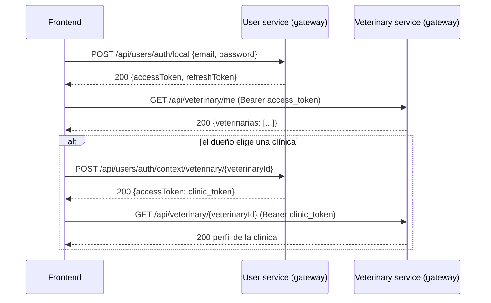
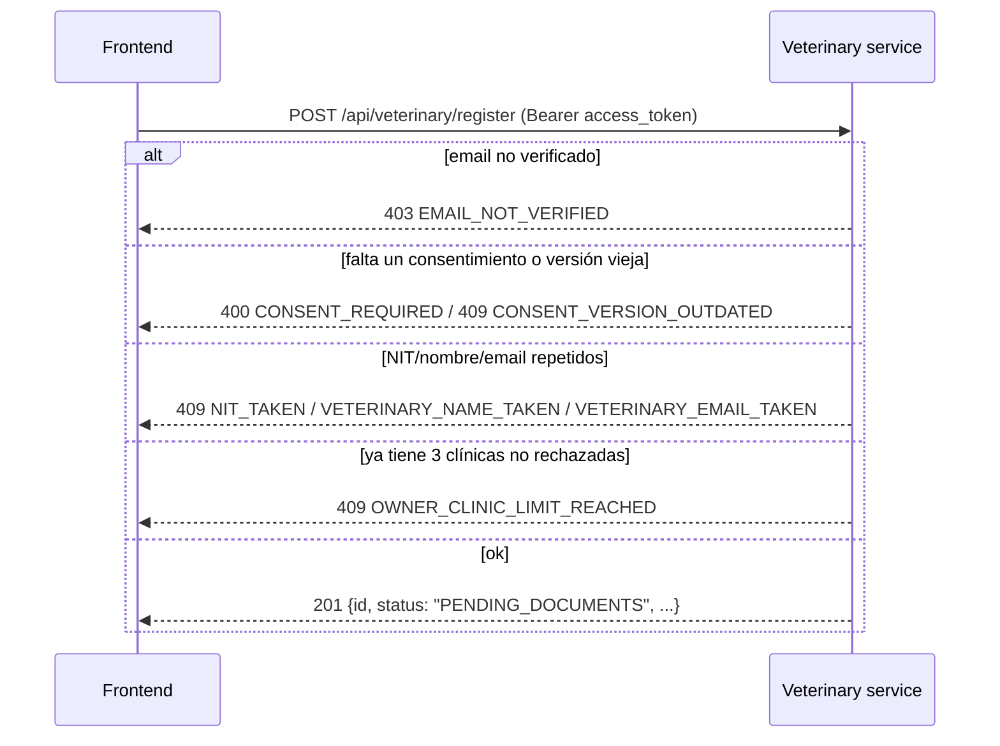
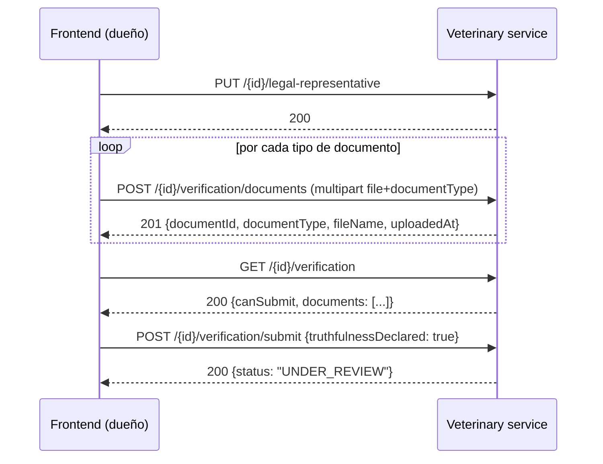
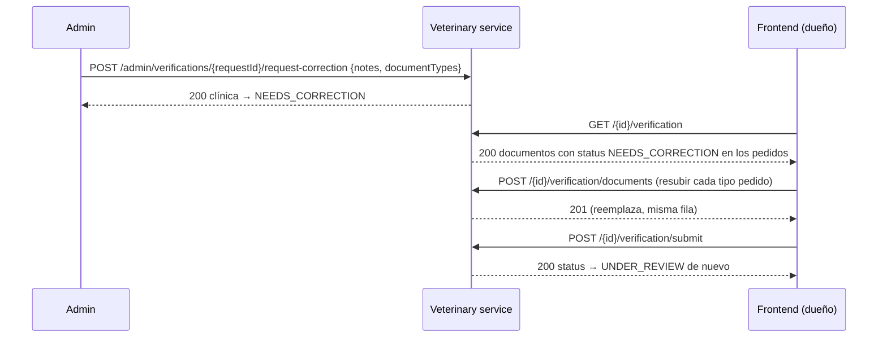
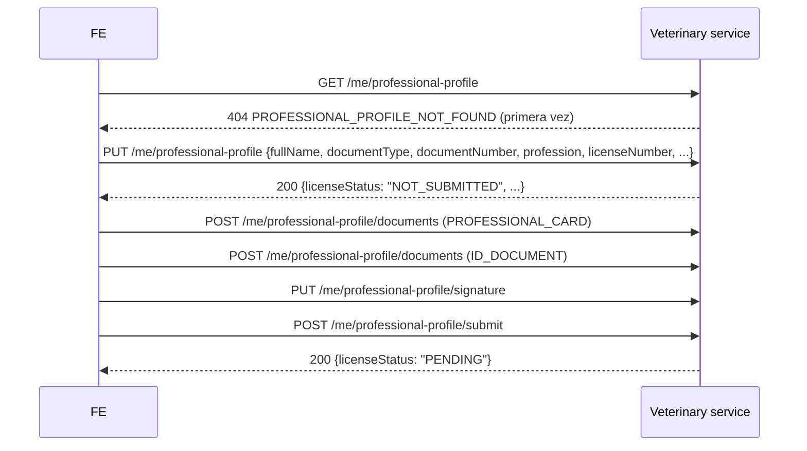
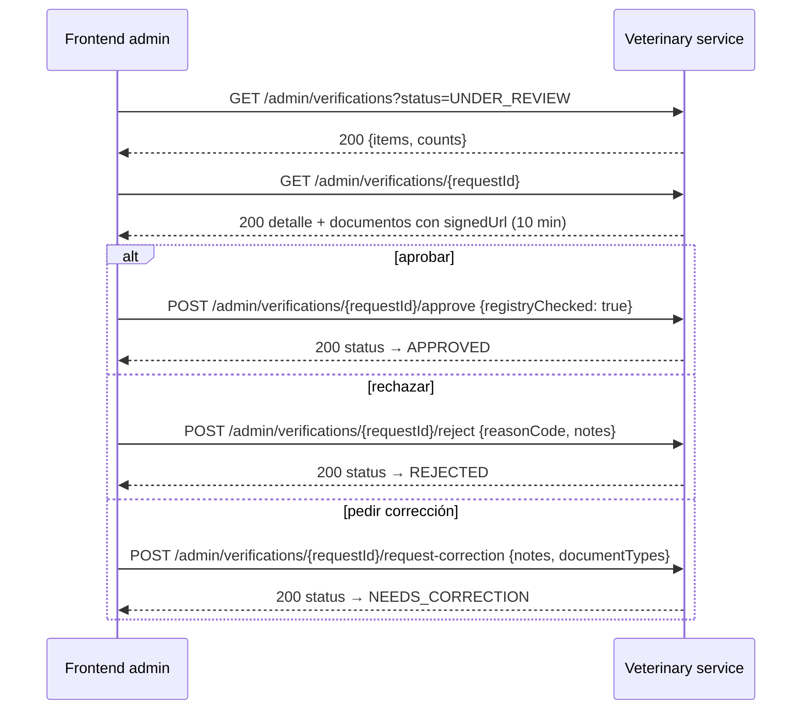
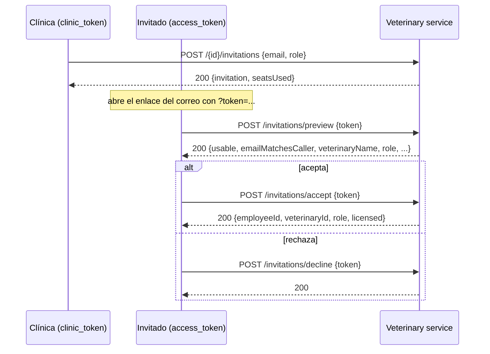

# Guía de integración frontend — `veterinary-service`

Esta guía está sacada del **código real** (controllers, DTOs, enums, excepciones y
`GlobalExceptionHandler`), no de los `.md` previos ni de memoria. Donde un `.md` anterior
(`FASE_2B_VERIFICACION.md`, `FASE_3_PERSONAL.md`, `CLAUDE.md`) decía algo distinto a lo que hace el
código, manda el código — las diferencias están anotadas en la [sección 9](#9-diferencias-con-los-md-anteriores).

Lectores: desarrollador frontend de la app de dueños (Ionic/Angular) y de la web de clínicas
(MyAnimaLogVet, Angular). Todos los ejemplos de request/response son literales de los DTOs del
backend — no inventados.

## Índice

- [0. Cómo usar esta guía + glosario](#0-cómo-usar-esta-guía--glosario)
- [1. Reglas generales](#1-reglas-generales)
- [2. Flujos](#2-flujos)
  - [a. Login y selección de contexto](#2a-login-y-selección-de-contexto)
  - [b. Registro de clínica](#2b-registro-de-clínica)
  - [c. Asistente de verificación](#2c-asistente-de-verificación)
  - [d. Corrección](#2d-corrección)
  - [e. Resultado: ACTIVE / REJECTED / SUSPENDED](#2e-resultado-active--rejected--suspended)
  - [f. Perfil profesional del veterinario](#2f-perfil-profesional-del-veterinario)
  - [g. Panel admin](#2g-panel-admin)
  - [h. Equipo](#2h-equipo)
- [3. Mapa estado → pantalla](#3-mapa-estado--pantalla)
- [4. Interfaces TypeScript](#4-interfaces-typescript)
- [5. Ejemplos Angular](#5-ejemplos-angular)
- [6. Tabla completa de codes de error](#6-tabla-completa-de-codes-de-error)
- [7. Errores comunes y cómo detectarlos](#7-errores-comunes-y-cómo-detectarlos)
- [8. Checklist de integración](#8-checklist-de-integración)
- [9. Diferencias con los .md anteriores](#9-diferencias-con-los-md-anteriores)

---

## 0. Cómo usar esta guía + glosario

Cada flujo de la sección 2 tiene: diagrama de secuencia, pasos numerados pantalla→request→respuesta,
ejemplos reales de request/response, y una tabla `code` de error → qué mostrar → qué hacer. Si estás
implementando una pantalla concreta, ve directo a su flujo; no hace falta leer todo en orden.

| Término | Qué es |
|---|---|
| `access_token` | JWT normal que devuelve el login del User service. `ctx` ausente o `USER`. Vive ~15 min (`CONTRATOS_COMPARTIDOS.md` §1.2). Úsalo para todo lo que no sea "operar dentro de una clínica concreta": registrar clínica, `GET /api/veterinary/me`, vincular/desvincular como cliente, perfil profesional propio, invitaciones del invitado. |
| `refresh_token` | Token opaco de 30 días, se usa contra el User service para renovar el `access_token` sin volver a pedir contraseña. |
| `clinic_token` | JWT con `ctx=VETERINARY`, `vet_id`, `employee_id`, `vet_role`, `vet_licensed`, `vet_status`. Se obtiene con `POST {USER_URL}/auth/context/veterinary/{veterinaryId}`. Documentado con vida de **60 minutos** en todo el repo (`VeterinaryAuthorizationService`, `FASE_3_PERSONAL.md`) — úsalo para todo lo que opera **sobre una clínica concreta** una vez que ya la elegiste (ver tabla de la sección 1). |
| `PLATFORM_ADMIN` | Authority que da acceso a `/api/veterinary/admin/**`. Un usuario con `platform_role=PLATFORM_ADMIN` en su token normal. |
| Estado de la **clínica** (`VeterinaryStatus`) | `PENDING_DOCUMENTS` → `UNDER_REVIEW` → (`NEEDS_CORRECTION` ↔ `UNDER_REVIEW`) → `ACTIVE` \| `REJECTED`; y desde `ACTIVE`: `SUSPENDED` (y vuelta a `ACTIVE`). |
| Estado de la **solicitud de verificación** (`VerificationRequestStatus`) | `DRAFT` → `UNDER_REVIEW` → `NEEDS_CORRECTION` (vuelve a `DRAFT`-like editable) \| `APPROVED` \| `REJECTED`. Es un objeto separado de la clínica (`verification_requests`), uno por intento. |
| Estado de la **licencia profesional** (`LicenseStatus`) | `NOT_SUBMITTED` → `PENDING` → `VERIFIED` \| `REJECTED`. Es de la **persona**, no del empleo: un veterinario tiene un solo perfil aunque trabaje en varias clínicas. |

---

## 1. Reglas generales

### 1.1 Todo va por el gateway

**Nunca** llames directo a la URL de Cloud Run de `veterinary-service` ni de `user-service` desde el
frontend. Siempre:

```
{{gateway_url}}/api/veterinary/...   → este servicio
{{gateway_url}}/api/users/...        → user-service (login, refresh, contexto de clínica)
```

El gateway solo enruta `/api/veterinary/**` hacia este servicio — por eso **no existe** un
`/admin/**` genérico accesible desde el frontend; las rutas de plataforma viven en
`/api/veterinary/admin/**` (confirmado en `SecurityConfig`: ese matcher existe exactamente porque el
gateway nunca reenvía un `/admin/**` suelto). `/internal/**` **nunca** se expone por el gateway —
son rutas servicio-a-servicio con `X-Internal-Api-Key`, no un JWT de usuario; si las ves accesibles
desde el navegador es una falla de configuración del gateway, no algo que el frontend deba usar.

### 1.2 Qué token usar

| Grupo de endpoints | Token |
|---|---|
| `POST /api/veterinary/register` | `access_token` (normal) |
| `GET /api/veterinary/me` (mis clínicas) | `access_token` |
| `GET/PUT/DELETE /api/veterinary/me/professional-profile/**`, `POST .../submit` | `access_token` |
| `POST/DELETE /api/veterinary/link/**` (vincular/desvincular como cliente) | `access_token` |
| `POST/GET /api/veterinary/invitations/**` (preview/accept/decline, **lado del invitado**) | `access_token` del invitado |
| `GET /api/veterinary/me/invitations` | `access_token` |
| Todo lo que opera **sobre una clínica concreta** (`/{veterinaryId}/...`: perfil, verificación, documentos, logo, configuración, empleados, invitaciones emitidas, equipo, transferencia) | `clinic_token` de esa clínica |
| `/api/veterinary/admin/**` (cola de revisión, clínicas, profesionales) | `access_token` con `platform_role=PLATFORM_ADMIN` — **no** un `clinic_token` |
| `/internal/**` | Nunca desde el frontend |

Nota importante: `requireVeterinaryOwner` (usado por el asistente de verificación) **también acepta
un `access_token` normal**, siempre que el backend verifique contra la base que seas el `OWNER`
activo de esa clínica — esto es a propósito, porque el asistente de verificación tiene que seguir
funcionando con la clínica en `REJECTED` (donde un `clinic_token` ya no se emitiría). En la práctica,
usa el `clinic_token` igual una vez que lo tengas; si todavía no lo tienes (justo después de
registrar la clínica, antes de pedir el primero), el `access_token` del login alcanza.

### 1.3 Cómo obtener y renovar el `clinic_token`

```http
POST {{gateway_url}}/api/users/auth/context/veterinary/{veterinaryId}
Authorization: Bearer {{access_token}}
```

(ruta en el User service: `POST /auth/context/veterinary/{veterinaryId}`, sin body — confirmado en
la colección de Postman, carpeta "00 · Autenticación").

- **Cuándo pedirlo**: justo después de que el usuario elige una clínica en el selector (pantalla de
  "Mis clínicas", `GET /api/veterinary/me`).
- **Cuándo renovarlo**: cada ~60 minutos (documentado de forma consistente en
  `VeterinaryAuthorizationService`, `FASE_2B_VERIFICACION.md`, `FASE_3_PERSONAL.md` — ver nota de
  discrepancia con el token normal en la [sección 9](#9-diferencias-con-los-md-anteriores)), **y
  además** cada vez que:
  - El admin aprueba/rechaza/suspende/reactiva la clínica (cambió `vet_status`).
  - Alguien cambia tu rol, te retira, o hay una transferencia de propiedad (cambió `vet_role`).
  - Recibís un `403 NOT_CLINIC_MEMBER` o `403 INSUFFICIENT_PERMISSION` con un token que "debería"
    seguir siendo válido por tiempo — **no es un bug, es exactamente este mecanismo**: el rol y el
    estado de la clínica se resuelven contra la base en cada petición
    (`VeterinaryAuthorizationService`), nunca desde el claim del token. El único campo que el backend
    sigue confiando del claim es `vet_licensed`.
- **Al cambiar de clínica**: pedí un `clinic_token` nuevo con el `veterinaryId` de la clínica
  destino — nunca reutilices el de la clínica anterior, ni asumas que un `clinic_token` sirve para
  más de una clínica (`TenantMismatchException` → `403 TENANT_MISMATCH` si lo intentás).

### 1.4 Formato de error — decide SIEMPRE por `code`

Toda respuesta de error (sea del `@RestControllerAdvice`, de un 401/403 del filtro de seguridad, o de
un `MethodArgumentNotValidException`) tiene esta forma exacta:

```json
{
  "timestamp": "2026-11-05T10:15:30.123",
  "status": 409,
  "error": "Conflict",
  "message": "Another upload for document type RUT is already in progress, try again",
  "code": "DOCUMENT_UPLOAD_CONFLICT"
}
```

**Nunca** decidas el flujo de la UI comparando `message` (está en inglés, pensado para logs, y puede
cambiar de texto sin avisar) ni solo por `status` (varios errores distintos comparten el mismo
`status`, p. ej. `409` lo usan 18 `code`s diferentes — ver sección 6). Siempre `if (err.code === '...')`.

### 1.5 Subida de archivos con `FormData`

```ts
const form = new FormData();
form.append('file', file); // nombre de campo EXACTO, ver tabla de cada endpoint
form.append('documentType', 'RUT'); // solo en los endpoints que lo piden

this.http.post(url, form, { headers }); // SIN Content-Type
```

- **Nunca pongas `Content-Type` a mano.** El navegador tiene que generar el header
  `multipart/form-data; boundary=----WebKitFormBoundary...` él mismo; si lo fijás manualmente
  (incluso a `multipart/form-data` sin el boundary), Spring no puede parsear las partes y falla.
- Nombres de campo exactos por endpoint (todos `@RequestParam`, nunca JSON):

  | Endpoint | Campos |
  |---|---|
  | `PUT /api/veterinary/{id}/logo` | `file` |
  | `POST /api/veterinary/{id}/verification/documents` | `file`, `documentType` |
  | `POST /api/veterinary/me/professional-profile/documents` | `file`, `documentType` |
  | `PUT /api/veterinary/me/professional-profile/signature` | `file` |

- Formatos/tamaños máximos (validados por **firma real del archivo**, no por el `Content-Type` que
  manda el navegador — subí un `.png` renombrado a `.pdf` y lo va a detectar como PNG igual):

  | Qué | Formatos | Máximo |
  |---|---|---|
  | Logo de la clínica | PNG, JPEG, WEBP | 2 MB |
  | Documentos de verificación (clínica y perfil profesional) | PDF, JPEG, PNG | 10 MB |
  | Firma del profesional | PNG únicamente | 1 MB |

  `400 INVALID_FILE_TYPE` si la firma no coincide con ninguno de los permitidos; `413 FILE_TOO_LARGE`
  si excede el tamaño. También hay un límite de Spring a nivel de request completo
  (`spring.servlet.multipart.max-file-size`/`max-request-size`, **10MB**) — para el logo (2MB) y la
  firma (1MB) nunca lo vas a tocar, pero tenlo en cuenta si algún día subís algo más grande.

### 1.6 Reintentos

- **Nunca reintentes automáticamente un `4xx`.** Un `400`/`403`/`404`/`409` significa que la petición
  está mal formada o el estado no lo permite — reintentarla sin cambiar nada da el mismo error.
  Excepción real y documentada: `409 DOCUMENT_UPLOAD_CONFLICT` — ahí **sí** es correcto reintentar
  una vez automáticamente o pedirle al usuario que reintente, porque es una carrera entre dos
  subidas simultáneas del mismo tipo de documento, no un error del cliente.
- **`503 EXTERNAL_SERVICE_UNAVAILABLE`**: Supabase Storage no respondió. Reintentable con backoff
  (p. ej. 1 reintento a los 2s).
- **Timeout / arranque en frío**: Cloud Run con `min-instances: 0` puede tardar ~20s en levantar un
  contenedor frío antes de responder la primera petición después de estar inactivo. **No muestres un
  error en el primer intento que tarda** — muestra un estado de "cargando" con un timeout generoso
  (≥25-30s) antes de considerar que falló de verdad. Esto no está instrumentado/medido en el código
  de este repo; es una recomendación de UX basada en el comportamiento típico de Cloud Run con
  escala a cero, no un valor que el backend garantice.

---

## 2. Flujos

### 2a. Login y selección de contexto



**Pasos**

1. Pantalla de login → `POST {{user_url}}/auth/local` con `{email, password}` → guarda
   `access_token`/`refresh_token`.
2. Pantalla "Mis clínicas" → `GET /api/veterinary/me` con `access_token`.
3. Si la lista está vacía: mostrar botón "Registrar mi clínica" → flujo 2b.
4. Si hay una o más: el dueño elige una → pedí el `clinic_token` → entrá a la pantalla de esa
   clínica (`GET /api/veterinary/{veterinaryId}` con el `clinic_token`, que trae `status` y, si
   aplica, `suspensionReason`).

**`GET /api/veterinary/me`** — sin chequeo de clínica, token normal. Lista las clínicas donde el
caller es empleado **activo**, con su rol y el estado de cada una:

```json
// 200
{
  "veterinarias": [
    { "veterinaryId": "9a1c2f3e-4b5d-6e7f-8a9b-0c1d2e3f4a5b", "name": "Clínica El Bosque", "role": "OWNER", "status": "PENDING_DOCUMENTS" },
    { "veterinaryId": "b2c3d4e5-f6a7-4890-1bcd-ef0123456789", "name": "VetCentro", "role": "VETERINARIAN", "status": "ACTIVE" }
  ]
}
```

| `code` | Mostrar | Qué hacer |
|---|---|---|
| `UNAUTHENTICATED` (401) | "Tu sesión expiró" | Refrescar token o volver al login |

---

### 2b. Registro de clínica



**`POST /api/veterinary/register`** — token normal, exige `email_verified=true`. El creador queda
como `OWNER` de la clínica nueva automáticamente (nunca se manda un `userId` en el body).

Request (`RegisterVeterinaryRequest` — **todos** estos campos son obligatorios salvo donde se indica):

```json
{
  "name": "Clínica El Bosque",
  "legalName": "Clínica Veterinaria El Bosque SAS",
  "nit": "900123456-7",
  "city": "Bogotá",
  "department": "Bogotá D.C.",
  "address": "Calle 80 # 15-20",
  "phone": "+573001234567",
  "email": "contacto@elbosque.com",
  "latitude": 4.678900,
  "longitude": -74.054300,
  "acceptedDataPolicyVersion": "2026-10-v1",
  "acceptedTermsVersion": "2026-10-v1"
}
```

- `name`, `legalName`, `city`, `department`, `address` — obligatorios, no vacíos.
- `phone` — obligatorio, regex `^\+?\d{7,15}$` (7 a 15 dígitos, `+` inicial opcional).
- `email` — obligatorio, formato de correo válido.
- `nit` — obligatorio, formato colombiano `123456789-0` con dígito de verificación DIAN válido
  (`InvalidNitException` si el formato o el dígito no cuadran).
- `latitude`/`longitude` — **opcionales**, pero si mandás una tenés que mandar la otra; rango
  `[-90,90]`/`[-180,180]`.
- `acceptedDataPolicyVersion`/`acceptedTermsVersion` — obligatorios y tienen que ser **exactamente
  iguales** a la versión vigente del backend (`app.legal.data-policy-version`/`terms-version`, hoy
  `2026-10-v1` por default) — pedí esa versión al backend o mantenela sincronizada, no la
  hardcodees sin verificar; si está vieja: `409 CONSENT_VERSION_OUTDATED`.

Response (201, `RegisterVeterinaryResponse`):

```json
{
  "id": "9a1c2f3e-4b5d-6e7f-8a9b-0c1d2e3f4a5b",
  "name": "Clínica El Bosque",
  "city": "Bogotá",
  "phone": "+573001234567",
  "email": "contacto@elbosque.com",
  "tenantId": "f3a1...-generado",
  "active": false,
  "status": "PENDING_DOCUMENTS",
  "legalName": "Clínica Veterinaria El Bosque SAS",
  "nit": "900123456-7",
  "department": "Bogotá D.C.",
  "address": "Calle 80 # 15-20",
  "latitude": 4.6789,
  "longitude": -74.0543,
  "logoUrl": null,
  "createdAt": "2026-11-05T10:00:00"
}
```

| `code` | HTTP | Mostrar | Qué hacer |
|---|---|---|---|
| `EMAIL_NOT_VERIFIED` | 403 | "Verificá tu correo antes de registrar una clínica" | Mandar a reenviar verificación |
| `CONSENT_REQUIRED` | 400 | "Aceptá la política de datos y los términos" | Resaltar los checkboxes |
| `CONSENT_VERSION_OUTDATED` | 409 | "Hay una versión nueva de los términos, aceptala de nuevo" | Recargar texto legal vigente |
| `VALIDATION_ERROR` | 400 | Mostrar el campo específico (`InvalidVeterinaryFieldException`/`InvalidVeterinaryEmailException`) | Resaltar el campo |
| `INVALID_NIT` | 400 | "El NIT no es válido" | Resaltar campo NIT |
| `VETERINARY_NAME_TAKEN` / `VETERINARY_EMAIL_TAKEN` / `NIT_TAKEN` | 409 | "Ya existe una clínica con ese nombre/correo/NIT" | Resaltar el campo correspondiente |
| `OWNER_CLINIC_LIMIT_REACHED` | 409 | "Ya tenés 3 clínicas activas o en proceso" | No permitir registrar otra |

---

### 2c. Asistente de verificación



Token: `access_token` normal o `clinic_token` (el backend siempre re-verifica en base que seas el
`OWNER` activo — `requireVeterinaryOwner`). Funciona con la clínica en cualquier estado, incluido
`REJECTED` (necesario para el reintento).

**Paso 1 — Representante legal**: `PUT /api/veterinary/{id}/legal-representative`

```json
// request
{ "isOwner": true, "fullName": "María Fernanda Gómez Restrepo", "documentType": "CC", "documentNumber": "1020304050" }
```

- `documentType`: `CC`, `CE` o `PPT`.
- `documentNumber`: con `CC` solo dígitos; con `CE`/`PPT` alfanumérico.
- Solo funciona si la solicitud está `DRAFT`/`NEEDS_CORRECTION` (`409 VERIFICATION_LOCKED` si no).

**Paso 2 — Documentos**. Tipos (`ClinicDocumentType`), en orden de obligatoriedad:

| `documentType` | Nombre | Obligatorio |
|---|---|---|
| `RUT` | RUT de la clínica | **Sí** |
| `CHAMBER_OF_COMMERCE` | Cámara de Comercio | **Sí** |
| `LEGAL_REP_ID` | Cédula del representante legal | **Sí** |
| `FACADE_PHOTO` | Foto de la fachada | No |

`POST /api/veterinary/{id}/verification/documents` — multipart `file` + `documentType`. **Volver a
subir el mismo tipo reemplaza al anterior**: es la **misma fila** (mismo `documentId`, `UPDATE`),
nunca una fila nueva — la restricción `ux_verification_documents_request_type` de la base solo
permite un documento por tipo por solicitud. El archivo nuevo se sube primero; si la transacción de
base de datos falla después, se borra de vuelta (compensación); el archivo **viejo** se borra del
bucket recién **después del commit**. Si dos subidas del mismo tipo llegan a la vez (carrera real,
no un error de tu código), la que pierde responde `409 DOCUMENT_UPLOAD_CONFLICT` — mostrale al
usuario "Otra subida de este documento está en curso, intentá de nuevo" y dejalo reintentar.

```json
// 201
{
  "documentId": "d1e2f3a4-b5c6-4d78-9e0f-1a2b3c4d5e6f",
  "requestId": "c3d4e5f6-a7b8-4910-8c2d-3e4f5a6b7c8d",
  "documentType": "RUT",
  "fileName": "rut-el-bosque.pdf",
  "uploadedAt": "2026-11-05T10:12:00"
}
```

`DELETE /api/veterinary/{id}/verification/documents/{documentId}` → `204`.

**Paso 3 — Ver estado**: `GET /api/veterinary/{id}/verification`

```json
// 200
{
  "veterinaryId": "9a1c2f3e-4b5d-6e7f-8a9b-0c1d2e3f4a5b",
  "veterinaryStatus": "PENDING_DOCUMENTS",
  "requestId": "c3d4e5f6-a7b8-4910-8c2d-3e4f5a6b7c8d",
  "requestStatus": "DRAFT",
  "attemptNumber": 1,
  "maxAttempts": 3,
  "attemptsRemaining": 2,
  "legalRepresentative": { "isOwner": true, "fullName": "María Fernanda Gómez Restrepo", "documentType": "CC", "documentNumber": "1020304050" },
  "documents": [
    { "documentType": "RUT", "required": true, "status": "READY", "documentId": "d1e2f3a4-...", "fileName": "rut-el-bosque.pdf", "uploadedAt": "2026-11-05T10:12:00" },
    { "documentType": "CHAMBER_OF_COMMERCE", "required": true, "status": "PENDING", "documentId": null, "fileName": null, "uploadedAt": null },
    { "documentType": "LEGAL_REP_ID", "required": true, "status": "PENDING", "documentId": null, "fileName": null, "uploadedAt": null },
    { "documentType": "FACADE_PHOTO", "required": false, "status": "PENDING", "documentId": null, "fileName": null, "uploadedAt": null }
  ],
  "professionalProfile": { "exists": false, "licenseStatus": null },
  "canEdit": true,
  "canSubmit": false,
  "missingRequired": ["CHAMBER_OF_COMMERCE", "LEGAL_REP_ID"],
  "documentsDeletionDate": null
}
```

`status` de cada documento (`VerificationDocumentStatusCalculator`): `PENDING` (no subido),
`READY` (subido y válido), `NEEDS_CORRECTION` (el admin pidió corregir este tipo y todavía no se
resubió después de pedido), `REVIEWED` (la solicitud está en corrección pero este tipo específico ya
había sido aprobado, no se puede tocar). `canSubmit` exige `canEdit` + representante legal completo +
los 3 documentos obligatorios.

**Paso 4 — Enviar**: `POST /api/veterinary/{id}/verification/submit`

```json
// request
{ "truthfulnessDeclared": true, "includeProfessionalProfile": false }
```

Si `includeProfessionalProfile: true`, envía también el perfil profesional del dueño en la misma
transacción (flujo 2f) — si ese perfil no está listo, falla **todo** y la clínica no queda enviada.

```json
// 200
{ "veterinaryId": "9a1c2f3e-...", "requestId": "c3d4e5f6-...", "status": "UNDER_REVIEW", "submittedAt": "2026-11-05T10:30:00" }
```

Mientras está `UNDER_REVIEW`: cualquier intento de editar representante legal o subir/borrar
documentos devuelve `409 VERIFICATION_LOCKED` — bloqueá esos botones en la UI en lugar de dejar que
el usuario choque contra el error.

| `code` | HTTP | Mostrar | Qué hacer |
|---|---|---|---|
| `NOT_VETERINARY_OWNER` | 403 | "No sos el dueño de esta clínica" | — |
| `VERIFICATION_LOCKED` | 409 | "Ya no podés editar, está en revisión" | Deshabilitar formulario |
| `INVALID_FILE_TYPE` | 400 | "El archivo debe ser PDF, JPEG o PNG" | Resaltar el input de archivo |
| `FILE_TOO_LARGE` | 413 | "El archivo supera los 10MB" | Resaltar el input de archivo |
| `DOCUMENT_UPLOAD_CONFLICT` | 409 | "Otra subida de este documento está en curso" | Reintentar |
| `DOCUMENT_NOT_IN_CORRECTION` | 409 | "Ese documento no fue pedido para corregir" | Solo mostrar editable los tipos de `correctionDocumentTypes` |
| `TRUTHFULNESS_DECLARATION_REQUIRED` | 400 | "Marcá la declaración de veracidad" | Resaltar checkbox |
| `MISSING_REQUIRED_DOCUMENTS` | 400 | "Faltan documentos obligatorios" | Usar `missingRequired` del GET |
| `INVALID_VERIFICATION_STATE` | 409 | "No se puede enviar en este estado" | Recargar estado |

---

### 2d. Corrección



- El dueño se entera por: (a) el evento `VERIFICATION_CORRECTION_REQUESTED` (correo, si
  `EVENTS_ENABLED=true`), y (b) `GET /{id}/verification` muestra `veterinaryStatus: "NEEDS_CORRECTION"`
  y `requestStatus: "NEEDS_CORRECTION"`.
- Los documentos a corregir son los que el admin puso en `documentTypes` al pedir la corrección —
  el GET los muestra con `status: "NEEDS_CORRECTION"` en la lista de `documents`; los que **no**
  fueron pedidos (ya aprobados) salen con `status: "REVIEWED"` y **no se pueden tocar**
  (`409 DOCUMENT_NOT_IN_CORRECTION` si lo intentás).
- Resubir cada tipo pedido = mismo endpoint de subida (reemplaza la fila). En cuanto se resube
  **después** de la fecha en que se pidió la corrección, ese documento vuelve a `READY`
  automáticamente (no hace falta ninguna llamada extra — se calcula comparando `uploadedAt` contra
  la fecha del pedido de corrección).
- Reenviar = el mismo `POST .../verification/submit` del flujo 2c.

| `code` | HTTP | Mostrar | Qué hacer |
|---|---|---|---|
| `DOCUMENT_NOT_IN_CORRECTION` | 409 | "Ese documento ya fue aprobado, no se puede resubir" | Deshabilitar ese input específico |

---

### 2e. Resultado: ACTIVE / REJECTED / SUSPENDED

**`ACTIVE`** (el admin aprobó): la clínica queda operativa, se le crea automáticamente una
suscripción de prueba `PRO_TRIAL` de 30 días si no tenía ninguna activa. A partir de aquí: invitar
personal (`STAFF_MANAGE` requiere clínica `ACTIVE` para `InviteEmployee`), generar código de invitación
de clientes, usar todas las pantallas operativas.

**`REJECTED`** (el admin rechazó): `GET /{id}/verification` trae `rejectionReason`/`rejectionReasonCode`
(`NOT_IN_REGISTRY`/`DATA_MISMATCH`/`DOCUMENT_INVALID`/`OTHER`) y `attemptsRemaining`. Mostrá el
motivo y, si `attemptsRemaining > 0`, el botón "Reintentar":

```http
POST /api/veterinary/{id}/verification/retry
```

Abre una solicitud `DRAFT` nueva (`attemptNumber + 1`, **sin copiar documentos viejos** — hay que
resubir todo) y la clínica vuelve a `PENDING_DOCUMENTS`. Si ya se agotaron los 3 intentos:
`409 VERIFICATION_ATTEMPTS_EXHAUSTED` — no mostrar el botón de reintentar en ese caso (usá
`attemptsRemaining === 0` del GET para decidirlo de antemano).

**`SUSPENDED`**: cualquier `403 CLINIC_SUSPENDED` en **cualquier** pantalla con `clinic_token`
(excepto el propio `GET /{id}` del perfil, que sigue respondiendo `200` a propósito para poder
explicar el estado) → redirigí a una pantalla de "Clínica suspendida" y llamá
`GET /api/veterinary/{id}` (funciona igual suspendida) para leer `suspensionReason`:

```json
{ "status": "SUSPENDED", "suspensionReason": "Documentación fraudulenta detectada en la revisión", "suspendedAt": "2026-11-01T09:00:00" }
```

No hay endpoint de "apelar" una suspensión desde el frontend del dueño — es una acción exclusiva del
admin (`PATCH /admin/veterinaries/{id}/reactivate`).

---

### 2f. Perfil profesional del veterinario

Token: `access_token` normal. El perfil es siempre el del `userId` del token — nunca pasa como
parámetro.



**`PUT /api/veterinary/me/professional-profile`** — crea o actualiza (`UpsertProfessionalProfileRequest`):

```json
{
  "fullName": "Juan David Martínez Soto",
  "documentType": "CC",
  "documentNumber": "1098765432",
  "profession": "MVZ",
  "licenseNumber": "MVZ-45821",
  "specialty": "Cirugía de tejidos blandos",
  "university": "Universidad Nacional de Colombia"
}
```

- Obligatorios: `fullName`, `documentType` (`CC`/`CE`/`PPT`), `documentNumber`, `profession`
  (`MV`/`MVZ`), `licenseNumber`.
- Opcionales: `specialty`, `university`.
- `licenseNumber` único — `409 LICENSE_NUMBER_TAKEN` si ya lo tiene otra persona.
- Con `licenseStatus=PENDING` **no se puede editar nada** → `409 VERIFICATION_LOCKED`.
- Con `licenseStatus=VERIFIED`: editar `specialty`/`university` no pasa nada; editar cualquier otro
  campo (identidad) vuelve el estado a `NOT_SUBMITTED` y abre un intento nuevo.
- Con `licenseStatus=REJECTED`: cualquier edición reintenta (máximo 3 intentos totales, igual que la
  clínica) — `409 VERIFICATION_ATTEMPTS_EXHAUSTED` al agotarlos.

**Documentos** (`ProfessionalDocumentType`):

| `documentType` | Obligatorio |
|---|---|
| `PROFESSIONAL_CARD` | **Sí** |
| `ID_DOCUMENT` | **Sí** |
| `DEGREE` | No |

Mismo endpoint/comportamiento de reemplazo que los documentos de la clínica
(`POST /me/professional-profile/documents`, multipart `file`+`documentType`; resubir reemplaza la
misma fila; `409 DOCUMENT_UPLOAD_CONFLICT` en carrera).

**Firma**: `PUT /me/professional-profile/signature` — multipart `file` (PNG, ≤1MB). A diferencia de
los documentos, se puede resubir en **cualquier** estado de la solicitud — no está sujeta a
`DRAFT`/`NEEDS_CORRECTION`.

**Enviar**: `POST /me/professional-profile/submit` — exige `PROFESSIONAL_CARD` e `ID_DOCUMENT`
subidos (`400 MISSING_REQUIRED_DOCUMENTS` si falta alguno). `licenseStatus → PENDING`.

| Estado de licencia | Qué significa |
|---|---|
| `NOT_SUBMITTED` | Sin enviar todavía (o reseteado por edición de identidad) |
| `PENDING` | Enviado, esperando revisión del admin — formulario bloqueado |
| `VERIFIED` | Aprobado — habilita `CLINICAL_WRITE` en las clínicas donde trabaja (según `RolePermissions`) |
| `REJECTED` | Rechazado — reintenta editando cualquier campo |

Un colega ve una versión reducida (`GET /{veterinaryId}/employees/{employeeId}/professional-profile`,
token de clínica, cualquier miembro activo): solo `fullName`, `profession`, `licenseNumber`,
`specialty`, `university`, `licenseStatus` — **nunca** `documentType`/`documentNumber` ni documentos
ni firma.

---

### 2g. Panel admin

Token: `access_token` con `platform_role=PLATFORM_ADMIN`. **Nunca** un `clinic_token`.



**Cola**: `GET /api/veterinary/admin/verifications?status=&subjectType=&page=&size=` — default
`status=UNDER_REVIEW` si no se manda. Respuesta con `items` + `counts` (por estado) + paginación.

**Detalle**: `GET /api/veterinary/admin/verifications/{requestId}` — datos declarados + `account`
(resuelto contra el User service, cae a `{id}` si falla) + documentos con `signedUrl` (vence a los
10 min — renovar con `GET .../{requestId}/documents/{documentId}/signed-url`) + bloque `ai` +
`duplicates` (mismo `sha256` en otro sujeto) + `history` de intentos anteriores.

**Decisiones** — las tres siguen exactamente el mismo patrón interno: requieren que la solicitud
esté `UNDER_REVIEW`, y **un admin no puede decidir sobre una solicitud que él mismo envió**
(`CannotReviewOwnRequestException` — `403 CANNOT_REVIEW_OWN_REQUEST`, se compara `submittedBy` de la
solicitud contra el `userId` del admin logueado). Esto importa para un admin que también es dueño de
una clínica: no puede aprobar/rechazar/pedir corrección de **su propia** solicitud.

- `POST .../approve` — body `{ "registryChecked": true, "notes": "..." }`. `registryChecked` es
  **obligatorio en `true`** (`400 REGISTRY_CHECK_REQUIRED` si no) — el admin tiene que marcar
  explícitamente que verificó en RUES/COMVEZCOL (usá `registryLookupUrl` del detalle para el enlace).
- `POST .../reject` — body `{ "reasonCode": "NOT_IN_REGISTRY" | "DATA_MISMATCH" | "DOCUMENT_INVALID" | "OTHER", "notes": "..." }` (`notes` obligatorio, máx. 1000 caracteres).
- `POST .../request-correction` — body `{ "notes": "...", "documentTypes": ["RUT", "LEGAL_REP_ID"] }`
  (ambos obligatorios; cada tipo tiene que pertenecer al sujeto — `400 INVALID_DOCUMENT_TYPE`
  si no).
- Dos admins no pueden decidir la misma solicitud a la vez: el segundo que llega recibe
  `409 INVALID_VERIFICATION_STATE` (la solicitud ya no está `UNDER_REVIEW` porque el primero ganó la
  carrera) — recargá la cola si lo ves.
- `POST .../rerun-ai` — solo si `AI_VERIFICATION_ENABLED=true` en el backend; si está apagada:
  `409 AI_VERIFICATION_DISABLED`.

**Pantalla Clínicas**: `GET /api/veterinary/admin/veterinaries?status=&search=&plan=&city=&department=&page=&size=`
(`size` máx. 50, default 20). `search` busca por nombre/razón social/NIT. Detalle:
`GET .../{veterinaryId}` (trae `ownerName`/`ownerEmail` resueltos contra el User service, con
fallback al representante legal si falla).

- **Suspender**: `PATCH /admin/veterinaries/{id}/suspend` — body `{ "reason": "..." }`
  (**obligatorio, 10 a 500 caracteres** — `400 VALIDATION_ERROR` fuera de ese rango). Solo
  `ACTIVE → SUSPENDED`; otro estado de origen → `409 CLINIC_NOT_ACTIVE`.
- **Reactivar**: `PATCH /admin/veterinaries/{id}/reactivate` — sin body. Solo `SUSPENDED → ACTIVE`;
  otro estado de origen → `409 CLINIC_NOT_SUSPENDED`.
- **Un admin no puede suspender/reactivar una clínica donde es empleado o dueño**
  (`403 CANNOT_MANAGE_OWN_CLINIC`) — ocultá o deshabilitá esos botones si el admin logueado aparece
  en la lista de empleados de esa clínica.

**Pantalla Profesionales**: `GET /api/veterinary/admin/professionals?search=&verified=&page=&size=`
(`search` solo por nombre/número de licencia, nunca correo — el perfil no lo guarda). Detalle:
`GET .../{profileId}` (único lugar donde se resuelve el correo del profesional contra el User
service).

| `code` | HTTP | Mostrar | Qué hacer |
|---|---|---|---|
| `PLATFORM_ADMIN_REQUIRED` | 403 | "No tenés permisos de administrador" | — |
| `REGISTRY_CHECK_REQUIRED` | 400 | "Marcá que verificaste en el registro" | Resaltar checkbox |
| `CANNOT_REVIEW_OWN_REQUEST` | 403 | "No podés revisar tu propia solicitud" | Ocultar botones de decisión |
| `INVALID_VERIFICATION_STATE` | 409 | "Otro admin ya decidió esta solicitud" | Recargar la cola |
| `AI_VERIFICATION_DISABLED` | 409 | "El análisis por IA está apagado" | Ocultar botón de rerun |
| `CANNOT_MANAGE_OWN_CLINIC` | 403 | "No podés administrar tu propia clínica" | Ocultar botones suspender/reactivar |
| `CLINIC_NOT_ACTIVE` / `CLINIC_NOT_SUSPENDED` | 409 | "El estado cambió, recargá" | Recargar fila |

---

### 2h. Equipo

**Invitar** (lado de la clínica, `clinic_token`, `STAFF_MANAGE`):

```http
POST /api/veterinary/{veterinaryId}/invitations
{ "email": "nuevo@vet.com", "role": "VETERINARIAN" }
```

- Roles invitables: `ADMIN`, `VETERINARIAN`, `ASSISTANT`, `RECEPTIONIST` — **nunca** `OWNER`
  (`400 INVALID_EMPLOYEE_ROLE`).
- Invitar con `role: "ADMIN"` exige además ser `OWNER` (`403 ONLY_OWNER_CAN_MANAGE_ADMINS` si un
  `ADMIN` lo intenta).
- Exige la clínica `ACTIVE` (`409 CLINIC_NOT_ACTIVE` si no).
- Una invitación `PENDING` vigente por clínica+correo (`409 INVITATION_ALREADY_PENDING`).
- La respuesta **nunca** incluye el token de la invitación — solo viaja en el correo
  (`EMPLOYEE_INVITED`, requiere `EVENTS_ENABLED=true`).



**Enlace del correo → pantalla de invitación**:

1. El enlace del correo apunta a `{INVITATION_BASE_URL}?token=<token>` — leé el `token` de la
   query string **apenas** cargue la pantalla.
2. **`preview` requiere sesión** — a diferencia de lo que uno esperaría de una pantalla "antes de
   decidir", `GetInvitationPreviewService` llama `authenticatedUserPort.current()`, que lanza
   `401 UNAUTHENTICATED` sin un token válido (necesita saber quién pregunta para calcular
   `emailMatchesCaller`). Si tu app **no** tiene una sesión guardada: guardá el `token` (ej. en
   `sessionStorage`) y mandá al login **antes** de llamar `preview`. Si ya hay sesión: llamá
   `preview` directo.
3. `POST /api/veterinary/invitations/preview` — body `{ "token": "..." }`, `access_token` del que
   está logueado. Responde `200` **incluso si la invitación ya no sirve** (vencida, usada, de otro
   correo) — son estados que pinta el frontend, no errores:

   ```json
   {
     "invitationId": "...", "veterinaryId": "...", "veterinaryName": "VetCentro", "veterinaryCity": "Bogotá",
     "logoUrl": "...", "role": "VETERINARIAN", "invitedByName": "Ana Pérez", "email": "nuevo@vet.com",
     "emailMatchesCaller": true, "status": "PENDING", "expired": false, "usable": true,
     "expiresAt": "2026-11-12T10:00:00"
   }
   ```

   El único error real es un token que no existe: `404 INVITATION_NOT_FOUND`.
4. Si `usable: false`: mostrá por qué (`status` ≠ `PENDING`, `expired: true`, o
   `emailMatchesCaller: false` — en este último caso, sugerí cerrar sesión y entrar con el correo
   invitado, sin revelar más detalle).
5. Aceptar: `POST /api/veterinary/invitations/accept` `{ "token": "..." }` — exige la clínica
   `ACTIVE`, correo del JWT == invitado, `email_verified=true`, invitación `PENDING` y no vencida (en
   ese orden — ver tabla de errores). Si ya es empleado activo: `409 EMPLOYEE_ALREADY_EXISTS`.
6. Rechazar: `POST /api/veterinary/invitations/decline` `{ "token": "..." }` — mismas validaciones de
   identidad/estado, pero **no** exige la clínica `ACTIVE`.

**Lista del equipo**: `GET /{veterinaryId}/employees?includeInactive=` — token de clínica, cualquier
rol activo (sin permiso específico — hasta `RECEPTIONIST` necesita ver con quién trabaja). Nunca
expone documento de identidad ni datos clínicos.

**Cambiar rol**: `PATCH /{veterinaryId}/employees/{employeeId}/role` `{ "role": "ADMIN" }` —
`STAFF_MANAGE`. Reglas en este orden: no podés modificarte a vos mismo
(`403 CANNOT_MODIFY_SELF`) → nadie modifica al `OWNER` (`403 CANNOT_MODIFY_OWNER`) → un `ADMIN` no
modifica a otro `ADMIN` (`403 CANNOT_MODIFY_PEER_ADMIN`) → solo el `OWNER` puede promover a `ADMIN`
(`403 ONLY_OWNER_CAN_MANAGE_ADMINS`) → no se puede asignar `OWNER` (`400 INVALID_EMPLOYEE_ROLE`).

**Retirar**: `DELETE /{veterinaryId}/employees/{employeeId}` — mismas reglas de "a quién puedo
tocar" que cambiar rol. Es un soft-delete (`active=false`), nunca borra historial.

**Salir** (el propio empleado, `requireMember` — funciona aunque la clínica esté suspendida):
`POST /{veterinaryId}/leave`. El `OWNER` no puede irse sin transferir primero
(`409 OWNER_MUST_TRANSFER_OWNERSHIP`).

**Transferir propiedad** (`OWNER` actual, `requireVeterinaryOwner`):
`POST /{veterinaryId}/ownership-transfer` `{ "newOwnerEmployeeId": "..." }` — el destino tiene que
ser empleado activo de la misma clínica. Respuesta incluye `legalRepresentativeChanged: false`:
**no** cambia el representante legal automáticamente, hay que actualizarlo aparte si corresponde
(flujo 2c, paso 1).

**Token de clínica de alguien retirado o con rol cambiado**: su token sigue teniendo el claim viejo
hasta que expire (~60 min), pero **la próxima petición falla igual** porque el rol/estado se
re-verifican contra la base en cada request — recibe `403 NOT_CLINIC_MEMBER` (si lo retiraron) o
`403 INSUFFICIENT_PERMISSION` (si le bajaron permisos) **de inmediato**, no al vencer el token.

| `code` | HTTP | Mostrar | Qué hacer |
|---|---|---|---|
| `INVITATION_ALREADY_PENDING` | 409 | "Ya hay una invitación pendiente para ese correo" | — |
| `ONLY_OWNER_CAN_MANAGE_ADMINS` | 403 | "Solo el dueño puede asignar el rol Admin" | Ocultar opción |
| `INVITATION_NOT_FOUND` | 404 | "El enlace no es válido" | — |
| `INVITATION_EMAIL_MISMATCH` | 403 | "Esta invitación es para otro correo" | Sugerir cambiar de cuenta |
| `INVITATION_NOT_PENDING` | 409 | "Esta invitación ya se usó o fue cancelada" | — |
| `INVITATION_EXPIRED` | 410 | "Esta invitación venció" | Pedir que la reenvíen |
| `EMPLOYEE_ALREADY_EXISTS` | 409 | "Ya sos parte del equipo" | Ir directo al dashboard |
| `CANNOT_MODIFY_SELF` / `CANNOT_MODIFY_OWNER` / `CANNOT_MODIFY_PEER_ADMIN` | 403 | "No podés modificar a esta persona" | Ocultar los botones sobre esa fila |
| `OWNER_MUST_TRANSFER_OWNERSHIP` | 409 | "Transferí la propiedad antes de salir" | Mostrar flujo de transferencia |
| `OWNERSHIP_TRANSFER_CONFLICT` | 409 | "Algo cambió, reintentá" | Recargar lista de empleados |
| `NOT_CLINIC_MEMBER` | 403 | "Ya no formás parte de esta clínica" | Pedir token de clínica nuevo / volver al selector |

---

## 3. Mapa estado → pantalla

### Estado de la clínica (`VeterinaryStatus`)

| Estado | Pantalla | Botones habilitados |
|---|---|---|
| `PENDING_DOCUMENTS` | Asistente de verificación (2c) | Subir documentos, representante legal, enviar (si `canSubmit`) |
| `UNDER_REVIEW` | "En revisión" (solo lectura) | Ninguno de edición — todo responde `409 VERIFICATION_LOCKED` |
| `NEEDS_CORRECTION` | Asistente con banner de corrección (2d) | Resubir solo los tipos pedidos, reenviar |
| `ACTIVE` | Dashboard operativo normal | Todo lo operativo (citas, pacientes, equipo, configuración) |
| `REJECTED` | "Rechazada" con motivo | "Reintentar" si `attemptsRemaining > 0` |
| `SUSPENDED` | "Suspendida" con motivo (`suspensionReason`) | Ninguno operativo — solo lectura del perfil |

### Estado de la solicitud de verificación (`VerificationRequestStatus`)

| Estado | Qué ve el dueño |
|---|---|
| `DRAFT` | Asistente editable |
| `UNDER_REVIEW` | "Tu solicitud está en revisión" |
| `NEEDS_CORRECTION` | Banner con los documentos a corregir (`correctionDocumentTypes` del detalle admin; el dueño los ve como `status: NEEDS_CORRECTION` en cada documento) |
| `APPROVED` | (la clínica ya pasó a `ACTIVE`, no se muestra como tal) |
| `REJECTED` | Motivo + botón reintentar |

### Estado de la licencia profesional (`LicenseStatus`)

| Estado | Pantalla |
|---|---|
| `NOT_SUBMITTED` | Formulario editable, botón "Enviar" habilitado si hay documentos obligatorios |
| `PENDING` | Formulario bloqueado, "En revisión" |
| `VERIFIED` | Insignia de verificado; editar identidad vuelve a `NOT_SUBMITTED` |
| `REJECTED` | Motivo + formulario editable (reintenta al guardar) |

---

## 4. Interfaces TypeScript

```typescript
// ---------- Sobre de error (todas las respuestas 4xx/5xx) ----------
export interface ApiError {
  timestamp: string;
  status: number;
  error: string;
  message: string;
  code: string;
}

// ---------- Enums (union types, valores exactos del backend) ----------
export type VeterinaryStatus = 'PENDING_DOCUMENTS' | 'UNDER_REVIEW' | 'NEEDS_CORRECTION' | 'ACTIVE' | 'REJECTED' | 'SUSPENDED';
export type VerificationRequestStatus = 'DRAFT' | 'UNDER_REVIEW' | 'NEEDS_CORRECTION' | 'APPROVED' | 'REJECTED';
export type LicenseStatus = 'NOT_SUBMITTED' | 'PENDING' | 'VERIFIED' | 'REJECTED';
export type EmployeeRole = 'OWNER' | 'ADMIN' | 'VETERINARIAN' | 'ASSISTANT' | 'RECEPTIONIST';
export type InvitationStatus = 'PENDING' | 'ACCEPTED' | 'DECLINED' | 'REVOKED'; // sin EXPIRED: se deriva de expiresAt
export type ClinicDocumentType = 'RUT' | 'CHAMBER_OF_COMMERCE' | 'LEGAL_REP_ID' | 'FACADE_PHOTO';
export type ProfessionalDocumentType = 'PROFESSIONAL_CARD' | 'ID_DOCUMENT' | 'DEGREE';
export type DocumentStatus = 'PENDING' | 'READY' | 'NEEDS_CORRECTION' | 'REVIEWED';
export type IdDocumentType = 'CC' | 'CE' | 'PPT';
export type Profession = 'MV' | 'MVZ';
export type SubjectType = 'CLINIC' | 'PROFESSIONAL';
export type AiStatus = 'NOT_RUN' | 'RUNNING' | 'DONE' | 'FAILED';
export type AiRiskLevel = 'LOW' | 'MEDIUM' | 'HIGH';
export type RejectionReasonCode = 'NOT_IN_REGISTRY' | 'DATA_MISMATCH' | 'DOCUMENT_INVALID' | 'OTHER';

// ---------- 2a. Mis clínicas ----------
export interface MyVeterinarySummary {
  veterinaryId: string;
  name: string;
  role: EmployeeRole;
  status: VeterinaryStatus;
}
export interface GetMyVeterinariesResponse {
  veterinarias: MyVeterinarySummary[]; // nombre real del campo en el DTO: "veterinaries" en Java -> serializado como "veterinaries"
}

// ---------- 2b. Registro ----------
export interface RegisterVeterinaryRequest {
  name: string;
  city: string;
  phone: string;
  email: string;
  legalName: string;
  nit: string;
  address: string;
  department: string;
  latitude?: number | null;
  longitude?: number | null;
  acceptedDataPolicyVersion: string;
  acceptedTermsVersion: string;
}
export interface RegisterVeterinaryResponse {
  id: string;
  name: string;
  city: string;
  phone: string;
  email: string;
  tenantId: string;
  active: boolean;
  status: VeterinaryStatus;
  legalName: string | null;
  nit: string | null;
  department: string | null;
  address: string | null;
  latitude: number | null;
  longitude: number | null;
  logoUrl: string | null;
  createdAt: string;
}

// ---------- Perfil de la clínica ----------
export interface GetVeterinaryProfileResponse {
  id: string;
  name: string;
  city: string;
  phone: string | null;
  email: string | null;
  tenantId: string;
  active: boolean;
  status: VeterinaryStatus;
  legalName: string | null;
  nit: string | null;
  address: string | null;
  department: string | null;
  latitude: number | null;
  longitude: number | null;
  timezone: string;
  currency: string;
  defaultAppointmentMinutes: number;
  allowOnlineBooking: boolean;
  bookingRequiresConfirmation: boolean;
  cancellationMinHours: number;
  directoryVisible: boolean;
  inviteCode: string | null;
  inviteLink: string | null;
  createdBy: string | null;
  createdAt: string;
  updatedAt: string | null;
  approvedAt: string | null;
  suspendedAt: string | null;
  suspensionReason: string | null;
}

// ---------- 2c. Verificación de la clínica ----------
export interface LegalRepresentativeInfo {
  isOwner: boolean | null;
  fullName: string | null;
  documentType: string | null; // "CC" | "CE" | "PPT"
  documentNumber: string | null;
}
export interface VerificationDocumentStatusInfo {
  documentType: string;
  required: boolean;
  status: DocumentStatus;
  documentId: string | null;
  fileName: string | null;
  uploadedAt: string | null;
}
export interface ProfessionalProfileSummary {
  exists: boolean;
  licenseStatus: LicenseStatus | null;
}
export interface GetClinicVerificationResponse {
  veterinaryId: string;
  veterinaryStatus: VeterinaryStatus;
  requestId: string;
  requestStatus: VerificationRequestStatus;
  attemptNumber: number;
  maxAttempts: number;
  attemptsRemaining: number;
  submittedAt: string | null;
  decidedAt: string | null;
  reviewerNotes: string | null;
  rejectionReason: string | null;
  rejectionReasonCode: RejectionReasonCode | null;
  legalRepresentative: LegalRepresentativeInfo | null;
  documents: VerificationDocumentStatusInfo[];
  professionalProfile: ProfessionalProfileSummary | null;
  canEdit: boolean;
  canSubmit: boolean;
  missingRequired: string[];
  documentsDeletionDate: string | null;
}
export interface UploadVerificationDocumentResponse {
  documentId: string;
  requestId: string;
  documentType: string;
  fileName: string | null;
  uploadedAt: string;
}
export interface SubmitClinicVerificationRequest {
  truthfulnessDeclared: boolean;
  includeProfessionalProfile?: boolean;
}
export interface SubmitClinicVerificationResponse {
  veterinaryId: string;
  requestId: string;
  status: VerificationRequestStatus;
  submittedAt: string;
}
export interface RetryClinicVerificationResponse {
  veterinaryId: string;
  requestId: string;
  status: VerificationRequestStatus;
  attemptNumber: number;
}
export interface UpdateLegalRepresentativeRequest {
  isOwner: boolean;
  fullName: string;
  documentType: 'CC' | 'CE' | 'PPT';
  documentNumber: string;
}

// ---------- 2f. Perfil profesional ----------
export interface UpsertProfessionalProfileRequest {
  fullName: string;
  documentType: IdDocumentType;
  documentNumber: string;
  profession: Profession;
  licenseNumber: string;
  specialty?: string | null;
  university?: string | null;
}
export interface ProfessionalProfileResponse {
  id: string;
  fullName: string;
  documentType: IdDocumentType;
  documentNumber: string;
  profession: Profession;
  licenseNumber: string;
  specialty: string | null;
  university: string | null;
  licenseStatus: LicenseStatus;
  documents: VerificationDocumentStatusInfo[];
  rejectionReasonCode: RejectionReasonCode | null;
}
export interface UploadProfessionalDocumentResponse {
  documentId: string;
  requestId: string;
  documentType: string;
  fileName: string | null;
  uploadedAt: string;
}
export interface UploadSignatureResponse {
  profileId: string;
  hasSignature: boolean;
}
export interface SubmitProfessionalProfileResponse {
  profileId: string;
  requestId: string;
  status: VerificationRequestStatus;
  licenseStatus: LicenseStatus;
  submittedAt: string;
}
export interface EmployeeProfessionalProfileResponse {
  exists: boolean;
  fullName: string | null;
  profession: Profession | null;
  licenseNumber: string | null;
  specialty: string | null;
  university: string | null;
  licenseStatus: LicenseStatus | null;
}

// ---------- 2g. Admin: verificaciones ----------
export interface AdminVerificationQueueItem {
  requestId: string;
  subjectType: SubjectType;
  subjectId: string;
  displayName: string;
  identifier: string; // NIT o número de licencia
  profession: string | null;
  submittedAt: string | null;
  attemptNumber: number;
  status: VerificationRequestStatus;
  aiStatus: AiStatus;
  aiRiskLevel: AiRiskLevel | null;
  duplicateFileAlert: boolean;
}
export interface AdminVerificationQueueResponse {
  items: AdminVerificationQueueItem[];
  page: number;
  size: number;
  total: number;
  counts: Record<string, number>; // por VerificationRequestStatus
}
export interface AdminAccountInfo { id: string; email: string | null; emailVerified: boolean | null; }
export interface AdminVerificationDocumentInfo {
  documentId: string;
  documentType: string;
  fileName: string | null;
  mimeType: string;
  fileSizeBytes: number;
  uploadedAt: string;
  issueDate: string | null;
  signedUrl: string | null;
  signedUrlExpiresAt: string | null;
}
export interface AdminAiInfo { aiStatus: AiStatus; aiRiskLevel: AiRiskLevel | null; report: Record<string, unknown> | null; }
export interface AdminDuplicateInfo { documentType: string; otherSubjectType: SubjectType; otherSubjectName: string | null; }
export interface AdminVerificationHistoryItem {
  attemptNumber: number;
  status: VerificationRequestStatus;
  rejectionReasonCode: RejectionReasonCode | null;
  reviewerNotes: string | null;
  decidedAt: string | null;
}
export interface AdminWorkplaceInfo { veterinaryId: string; name: string; role: EmployeeRole; }
export interface LegalRepresentativeInfoAdmin { isOwner: boolean | null; fullName: string | null; documentType: string | null; documentNumber: string | null; }
export interface AdminClinicDetailData {
  name: string; legalName: string | null; nit: string | null; phone: string | null; email: string | null;
  address: string | null; city: string | null; department: string | null; logoUrl: string | null;
  legalRepresentative: LegalRepresentativeInfoAdmin | null;
}
export interface AdminProfessionalDetailData {
  fullName: string; documentType: IdDocumentType; documentNumber: string; profession: Profession;
  licenseNumber: string; specialty: string | null; university: string | null; workplaces: AdminWorkplaceInfo[];
}
export interface AdminVerificationDetailResponse {
  requestId: string;
  subjectType: SubjectType;
  subjectId: string;
  status: VerificationRequestStatus;
  clinic: AdminClinicDetailData | null;
  professional: AdminProfessionalDetailData | null;
  account: AdminAccountInfo | null;
  attemptNumber: number;
  maxAttempts: number;
  attemptsRemaining: number;
  documents: AdminVerificationDocumentInfo[];
  ai: AdminAiInfo | null;
  duplicates: AdminDuplicateInfo[];
  history: AdminVerificationHistoryItem[];
  registryLookupUrl: string | null;
  submittedAt: string | null;
  decidedAt: string | null;
}
export interface ApproveVerificationRequest { registryChecked: boolean; notes?: string | null; }
export interface ApproveVerificationResponse {
  requestId: string; subjectType: SubjectType; status: VerificationRequestStatus; decidedAt: string;
  trialEndsAt: string | null; // solo si subjectType === 'CLINIC' y no tenía suscripción activa
}
export interface RejectVerificationRequest { reasonCode: RejectionReasonCode; notes: string; }
export interface RejectVerificationResponse {
  requestId: string; subjectType: SubjectType; status: VerificationRequestStatus; decidedAt: string;
  attemptsRemaining: number; documentsDeletionDate: string | null;
}
export interface RequestVerificationCorrectionRequest { notes: string; documentTypes: string[]; }
export interface RequestVerificationCorrectionResponse {
  requestId: string; subjectType: SubjectType; status: VerificationRequestStatus;
  correctionDocumentTypes: string[]; correctionRequestedAt: string;
}
export interface RenewSignedUrlResponse { signedUrl: string; expiresAt: string; }
export interface RerunVerificationAnalysisResponse { requestId: string; aiStatus: AiStatus; }

// ---------- 2g. Admin: clínicas / profesionales ----------
export interface AdminClinicListItem {
  id: string; name: string; legalName: string | null; nit: string | null; city: string | null;
  department: string | null; status: VeterinaryStatus; plan: string | null; legalRepName: string | null;
  employeesCount: number; createdAt: string; approvedAt: string | null; suspendedAt: string | null;
}
export interface AdminClinicListResponse { items: AdminClinicListItem[]; page: number; size: number; total: number; }
export interface AdminEmployeeInfo { employeeId: string; userId: string; role: EmployeeRole; active: boolean; }
export interface AdminClinicDetailResponse {
  id: string; name: string; legalName: string | null; nit: string | null; phone: string | null;
  email: string | null; address: string | null; city: string | null; department: string | null;
  status: VeterinaryStatus; plan: string | null; legalRepName: string | null; ownerName: string | null;
  ownerEmail: string | null; createdAt: string; approvedAt: string | null; suspendedAt: string | null;
  suspensionReason: string | null; employees: AdminEmployeeInfo[]; verificationHistory: AdminVerificationHistoryItem[];
}
export interface SuspendVeterinaryRequest { reason: string; } // 10-500 caracteres
export interface SuspendVeterinaryResponse {
  id: string; name: string; status: VeterinaryStatus; active: boolean; suspendedAt: string; suspensionReason: string;
}
export interface ReactivateVeterinaryResponse { id: string; name: string; status: VeterinaryStatus; active: boolean; approvedAt: string | null; }
export interface AdminProfessionalListItem {
  id: string; fullName: string; licenseNumber: string; profession: Profession; licenseStatus: LicenseStatus;
  workplaces: AdminWorkplaceInfo[]; createdAt: string;
}
export interface AdminProfessionalListResponse { items: AdminProfessionalListItem[]; page: number; size: number; total: number; }
export interface AdminProfessionalDetailResponse {
  id: string; fullName: string; email: string | null; documentType: IdDocumentType; documentNumber: string;
  licenseNumber: string; profession: Profession; specialty: string | null; university: string | null;
  licenseStatus: LicenseStatus; rejectionReason: string | null; verifiedAt: string | null;
  workplaces: AdminWorkplaceInfo[]; createdAt: string;
}

// ---------- 2h. Equipo / invitaciones ----------
export interface InviteEmployeeRequest { email: string; role: EmployeeRole; }
export interface InvitationSummary {
  id: string; veterinaryId: string; email: string; role: EmployeeRole; status: InvitationStatus;
  expired: boolean; invitedBy: string; expiresAt: string; decidedAt: string | null; createdAt: string;
}
export interface InviteEmployeeResponse { invitation: InvitationSummary; seatsUsed: number; }
export interface ListInvitationsResponse { invitations: InvitationSummary[]; }
export interface ResendInvitationResponse { invitation: InvitationSummary; }
export interface RevokeInvitationResponse { invitation: InvitationSummary; }
export interface GetInvitationPreviewRequest { token: string; }
export interface GetInvitationPreviewResponse {
  invitationId: string; veterinaryId: string; veterinaryName: string | null; veterinaryCity: string | null;
  logoUrl: string | null; role: EmployeeRole; invitedByName: string | null; email: string;
  emailMatchesCaller: boolean; status: InvitationStatus; expired: boolean; usable: boolean; expiresAt: string;
}
export interface AcceptInvitationRequest { token: string; }
export interface AcceptInvitationResponse {
  employeeId: string; veterinaryId: string; veterinaryName: string; role: EmployeeRole;
  licensed: boolean; reactivated: boolean;
}
export interface DeclineInvitationRequest { token: string; }
export interface DeclineInvitationResponse { invitationId: string; veterinaryId: string; status: InvitationStatus; decidedAt: string; }
export interface MyInvitation {
  invitationId: string; veterinaryId: string; veterinaryName: string | null; veterinaryCity: string | null;
  logoUrl: string | null; role: EmployeeRole; expiresAt: string;
}
export interface GetMyInvitationsResponse { invitations: MyInvitation[]; }
export interface EmployeeListItem {
  employeeId: string; userId: string; name: string | null; email: string | null; role: EmployeeRole;
  active: boolean; createdAt: string; removedAt: string | null; self: boolean;
}
export interface ListEmployeesResponse { employees: EmployeeListItem[]; }
export interface UpdateEmployeeRoleRequest { role: EmployeeRole; }
export interface UpdateEmployeeRoleResponse { id: string; veterinaryId: string; userId: string; role: EmployeeRole; }
export interface DeActivateEmployeeResponse { id: string; veterinaryId: string; userId: string; role: EmployeeRole; active: boolean; }
export interface LeaveVeterinaryResponse { employeeId: string; veterinaryId: string; removedAt: string; }
export interface TransferOwnershipRequest { newOwnerEmployeeId: string; }
export interface TransferOwnershipParty { employeeId: string; userId: string; role: EmployeeRole; }
export interface TransferOwnershipResponse {
  veterinaryId: string; previousOwner: TransferOwnershipParty; newOwner: TransferOwnershipParty;
  legalRepresentativeChanged: false;
}
```

---

## 5. Ejemplos Angular

### 5.1 Interceptor — token correcto por tipo de ruta

```typescript
import { HttpInterceptorFn } from '@angular/common/http';
import { inject } from '@angular/core';
import { AuthStore } from './auth.store'; // tu store de tokens

export const authInterceptor: HttpInterceptorFn = (req, next) => {
  const auth = inject(AuthStore);

  // Rutas de administración de plataforma: siempre el access_token con platform_role=PLATFORM_ADMIN
  if (req.url.includes('/api/veterinary/admin/')) {
    return next(req.clone({ setHeaders: { Authorization: `Bearer ${auth.adminAccessToken()}` } }));
  }

  // Rutas que operan sobre una clínica concreta (/api/veterinary/{id}/...)
  const isClinicScoped = /\/api\/veterinary\/[0-9a-f-]{36}\//.test(req.url);
  if (isClinicScoped && auth.clinicToken()) {
    return next(req.clone({ setHeaders: { Authorization: `Bearer ${auth.clinicToken()}` } }));
  }

  // Todo lo demás: access_token normal
  return next(req.clone({ setHeaders: { Authorization: `Bearer ${auth.accessToken()}` } }));
};
```

### 5.2 Manejo de error por `code` (no por `message` ni solo por `status`)

```typescript
import { HttpErrorResponse } from '@angular/common/http';

export interface ApiError { timestamp: string; status: number; error: string; message: string; code: string; }

export function handleApiError(err: HttpErrorResponse, router: Router, toast: ToastService): void {
  const body = err.error as ApiError | undefined;
  const code = body?.code;

  switch (code) {
    case 'UNAUTHENTICATED':
      router.navigate(['/login']);
      return;
    case 'NOT_CLINIC_MEMBER':
    case 'CLINIC_SUSPENDED':
      // el token de clínica quedó obsoleto o la clínica está suspendida — volver al selector
      router.navigate(['/mis-clinicas']);
      return;
    case 'DOCUMENT_UPLOAD_CONFLICT':
      toast.warn('Otra subida de este documento está en curso, intentá de nuevo en un momento.');
      return;
    case 'VERIFICATION_LOCKED':
      toast.info('La solicitud ya está en revisión, no se puede editar.');
      return;
    default:
      // 4xx desconocido: no reintentar. 5xx/503: considerar un reintento con backoff fuera de esta función.
      toast.error(body?.message ?? 'Ocurrió un error inesperado.');
  }
}
```

### 5.3 Subida de documento con progreso (`FormData`, sin `Content-Type` manual)

```typescript
import { HttpClient, HttpEventType } from '@angular/common/http';
import { Observable } from 'rxjs';
import { filter, map } from 'rxjs/operators';

export function uploadVerificationDocument(
  http: HttpClient,
  veterinaryId: string,
  file: File,
  documentType: 'RUT' | 'CHAMBER_OF_COMMERCE' | 'LEGAL_REP_ID' | 'FACADE_PHOTO'
): Observable<number | UploadVerificationDocumentResponse> {
  const form = new FormData();
  form.append('file', file);
  form.append('documentType', documentType);

  return http
    .post<UploadVerificationDocumentResponse>(
      `${environment.gatewayUrl}/api/veterinary/${veterinaryId}/verification/documents`,
      form,
      { reportProgress: true, observe: 'events' } // NUNCA headers Content-Type aquí
    )
    .pipe(
      filter((e) => e.type === HttpEventType.UploadProgress || e.type === HttpEventType.Response),
      map((e) =>
        e.type === HttpEventType.UploadProgress && e.total
          ? Math.round((100 * e.loaded) / e.total)
          : (e as any).body
      )
    );
}
```

---

## 6. Tabla completa de codes de error

Sacada línea por línea de `GlobalExceptionHandler` (y de `SecurityErrorResponseWriter` para los dos
casos resueltos a nivel de filtro, antes de llegar al `@RestControllerAdvice`).

| HTTP | `code` | Significado | Mensaje sugerido |
|---|---|---|---|
| 400 | `VALIDATION_ERROR` | Campo inválido (reusado por muchas validaciones distintas — `@Valid`, nombre/email de clínica, campos de registro, representante legal, tipo de documento, perfil profesional, decisión del admin, etc.) | "Revisá los datos del formulario" |
| 400 | `INVALID_NIT` | NIT con formato o dígito de verificación inválido | "El NIT no es válido" |
| 400 | `INVALID_EMPLOYEE_ROLE` | Rol no permitido (p. ej. intentar asignar `OWNER`) | "Ese rol no se puede asignar así" |
| 400 | `INVALID_INVITE_CODE` | Código de invitación de cliente inválido | "El código no es válido" |
| 400 | `CONSENT_REQUIRED` | Falta aceptar política de datos o términos | "Aceptá la política de datos y los términos" |
| 400 | `TRUTHFULNESS_DECLARATION_REQUIRED` | Falta `truthfulnessDeclared: true` | "Marcá la declaración de veracidad" |
| 400 | `MISSING_REQUIRED_DOCUMENTS` | Falta un documento obligatorio al enviar | "Subí todos los documentos obligatorios" |
| 400 | `INVALID_FILE_TYPE` | El archivo no es del formato esperado (por firma real) | "El archivo debe ser PDF/JPEG/PNG (o PNG, según el caso)" |
| 400 | `REGISTRY_CHECK_REQUIRED` | El admin no marcó `registryChecked` | "Marcá que verificaste en el registro oficial" |
| 401 | `UNAUTHENTICATED` | Sin JWT o inválido/vencido | "Tu sesión expiró, iniciá sesión de nuevo" |
| 403 | `EMAIL_NOT_VERIFIED` | Correo sin verificar | "Verificá tu correo antes de continuar" |
| 403 | `TENANT_MISMATCH` | El `clinic_token` es de otra clínica | "Pedí un token para esta clínica" |
| 403 | `INSUFFICIENT_PERMISSION` | No tenés el permiso necesario | "No tenés permiso para esta acción" |
| 403 | `PLATFORM_ADMIN_REQUIRED` | No sos `PLATFORM_ADMIN` | "No tenés permisos de administrador" |
| 403 | `CANNOT_MODIFY_SELF` | Intentaste modificarte/retirarte a vos mismo por esa vía | "No podés hacer esto sobre tu propio usuario" |
| 403 | `CANNOT_MODIFY_OWNER` | Nadie puede modificar al `OWNER` | "No se puede modificar al dueño" |
| 403 | `CANNOT_MODIFY_PEER_ADMIN` | Un `ADMIN` no puede modificar a otro `ADMIN` | "Solo el dueño puede modificar a otro admin" |
| 403 | `CLINIC_CONTEXT_REQUIRED` | Falta token de clínica | "Elegí una clínica primero" |
| 403 | `NOT_VETERINARY_OWNER` | No sos el `OWNER` activo de esa clínica | "No sos el dueño de esta clínica" |
| 403 | `CANNOT_REVIEW_OWN_REQUEST` | Admin intentando decidir su propia solicitud | "No podés revisar tu propia solicitud" |
| 403 | `CLINIC_SUSPENDED` | La clínica está suspendida | "Esta clínica está suspendida" |
| 403 | `NOT_CLINIC_MEMBER` | Tu `clinic_token` ya no corresponde (te retiraron/cambió tu membresía) | "Ya no formás parte de esta clínica" |
| 403 | `ONLY_OWNER_CAN_MANAGE_ADMINS` | Solo el `OWNER` puede crear/tocar `ADMIN`s | "Solo el dueño puede hacer esto" |
| 403 | `INVITATION_EMAIL_MISMATCH` | El correo logueado no es el invitado | "Esta invitación es para otro correo" |
| 403 | `CANNOT_MANAGE_OWN_CLINIC` | Admin suspendiendo/reactivando su propia clínica | "No podés administrar tu propia clínica" |
| 404 | `VETERINARY_NOT_FOUND` | Clínica inexistente | "No encontramos esa clínica" |
| 404 | `EMPLOYEE_NOT_FOUND` | Empleado inexistente o de otra clínica | "No encontramos ese empleado" |
| 404 | `SUBSCRIPTION_NOT_FOUND` | Suscripción inexistente | — |
| 404 | `NO_ACTIVE_SUBSCRIPTION` | Sin suscripción activa | "No hay un plan activo" |
| 404 | `USER_NOT_LINKED` | Cliente no vinculado a la clínica | — |
| 404 | `NOT_FOUND` | Ruta sin handler (unmapped route) | "Recurso no encontrado" |
| 404 | `DOCUMENT_NOT_FOUND` | Documento inexistente o de otra solicitud | "No encontramos ese documento" |
| 404 | `VERIFICATION_REQUEST_NOT_FOUND` | Solicitud de verificación inexistente | — |
| 404 | `INVITATION_NOT_FOUND` | Token de invitación inexistente (o de otra clínica) | "El enlace no es válido" |
| 404 | `PROFESSIONAL_PROFILE_NOT_FOUND` | El usuario todavía no tiene perfil profesional | "Completá tu perfil profesional" |
| 409 | `VETERINARY_NAME_TAKEN` | Nombre de clínica repetido | "Ya existe una clínica con ese nombre" |
| 409 | `VETERINARY_EMAIL_TAKEN` | Correo de clínica repetido | "Ya existe una clínica con ese correo" |
| 409 | `NIT_TAKEN` | NIT repetido | "Ya existe una clínica con ese NIT" |
| 409 | `OWNER_CLINIC_LIMIT_REACHED` | Ya tiene 3 clínicas no rechazadas | "Llegaste al límite de clínicas" |
| 409 | `VETERINARY_NOT_ACTIVE` | La clínica no está activa (vincular/suscripción) | "Esta clínica aún no está activa" |
| 409 | `CONSENT_VERSION_OUTDATED` | Versión de consentimiento vieja | "Aceptá la versión actual de los términos" |
| 409 | `VERIFICATION_LOCKED` | La solicitud no es editable (no `DRAFT`/`NEEDS_CORRECTION`) | "No se puede editar en este momento" |
| 409 | `INVALID_VERIFICATION_STATE` | Transición de estado inválida (incluye carrera entre dos admins) | "El estado cambió, recargá la pantalla" |
| 409 | `CLINIC_NOT_ACTIVE` | `suspend` sobre una clínica que no está `ACTIVE` | "El estado de la clínica cambió" |
| 409 | `CLINIC_NOT_SUSPENDED` | `reactivate` sobre una clínica que no está `SUSPENDED` | "El estado de la clínica cambió" |
| 409 | `VERIFICATION_ATTEMPTS_EXHAUSTED` | Se agotaron los 3 intentos | "Se agotaron los intentos, contactá soporte" |
| 409 | `EMPLOYEE_ALREADY_EXISTS` | Ya es empleado activo | "Ya sos parte del equipo" |
| 409 | `INVITATION_ALREADY_PENDING` | Invitación pendiente duplicada | "Ya hay una invitación pendiente para ese correo" |
| 409 | `INVITATION_NOT_PENDING` | Invitación ya decidida/revocada | "Esta invitación ya no está disponible" |
| 409 | `OWNER_MUST_TRANSFER_OWNERSHIP` | El `OWNER` intenta salir sin transferir | "Transferí la propiedad antes de salir" |
| 409 | `OWNERSHIP_TRANSFER_CONFLICT` | Carrera en la transferencia (dos updates no coincidieron) | "Algo cambió, reintentá" |
| 409 | `ACTIVE_SUBSCRIPTION_ALREADY_EXISTS` | Ya hay un plan activo | — |
| 409 | `USER_ALREADY_LINKED` | Cliente ya vinculado | "Ya estás vinculado a esta clínica" |
| 409 | `DOCUMENT_NOT_IN_CORRECTION` | En `NEEDS_CORRECTION`, ese tipo no fue pedido | "Ese documento ya fue aprobado" |
| 409 | `DOCUMENT_UPLOAD_CONFLICT` | Dos subidas del mismo tipo chocaron (carrera) | "Otra subida está en curso, intentá de nuevo" |
| 409 | `AI_VERIFICATION_DISABLED` | IA de verificación apagada | "El análisis automático está desactivado" |
| 409 | `LICENSE_NUMBER_TAKEN` | Número de licencia repetido | "Ese número de licencia ya está registrado" |
| 410 | `INVITATION_EXPIRED` | Invitación `PENDING` pero vencida | "Esta invitación venció, pedí que te reenvíen una" |
| 413 | `FILE_TOO_LARGE` | Archivo excede el máximo | "El archivo es demasiado grande" |
| 503 | `EXTERNAL_SERVICE_UNAVAILABLE` | Falla de Supabase Storage | "No pudimos subir el archivo, intentá de nuevo" |
| 500 | `INTERNAL_ERROR` | Error inesperado del servidor (catch-all, incluye `DataIntegrityViolationException` no mapeada específicamente) | "Ocurrió un error, intentá de nuevo" |

**Codes del lado del User service** (al pedir el `clinic_token` con
`POST /auth/context/veterinary/{id}`) — **no son verificables desde este repositorio**, son contrato
esperado del User service; confirmalos con ese equipo antes de depender de ellos en producción:

| `code` (esperado) | Significado |
|---|---|
| `NOT_A_VETERINARY_MEMBER` | El usuario no es empleado activo de esa clínica |
| `VETERINARY_SUSPENDED` | La clínica está suspendida (el User service no debería emitir el token) |
| `VETERINARY_REJECTED` | La clínica fue rechazada |

---

## 7. Errores comunes y cómo detectarlos

| Síntoma | Causa probable | Cómo confirmarlo |
|---|---|---|
| `403 TENANT_MISMATCH` o `403 INSUFFICIENT_PERMISSION` constante en rutas `/{veterinaryId}/...` | Estás usando un `clinic_token` de **otra** clínica, o el `access_token` normal donde se esperaba uno de clínica | Compará el `vet_id` del JWT (decodificalo, es un JWT normal) contra el `veterinaryId` de la URL |
| `400` al subir un archivo que "se ve bien" en Postman pero falla desde el navegador | Pusiste `Content-Type: multipart/form-data` a mano, sin el `boundary` | Quitá el header `Content-Type` del request — dejá que el navegador lo ponga |
| `404 EMPLOYEE_NOT_FOUND` en vez de un `403` al tocar un empleado | El `employeeId` es de **otra** clínica — el backend responde `404` a propósito en vez de `403 TENANT_MISMATCH`, para no revelar que ese `employeeId` existe en otra clínica | Verificá que el `employeeId` salió de un `GET /{veterinaryId}/employees` de la clínica correcta |
| El frontend funciona en Postman/local pero no en producción | Estás llamando directo a la URL de Cloud Run en vez de al gateway | Revisá que la variable de entorno de la URL base sea `{{gateway_url}}`, no `https://veterinary-service-xxxx.run.app` |
| El primer request del día tarda ~20s y parece "colgado" | Arranque en frío de Cloud Run (`min-instances: 0`) | Normal — asegurate de tener un timeout generoso y un estado de "cargando", no un error inmediato |
| Reintentar automáticamente un `409 VERIFICATION_LOCKED` o `409 CLINIC_NOT_ACTIVE` sin cambiar nada | El estado no cambia solo porque reintentes — es un error de flujo, no transitorio | Recargá el estado real (`GET`) antes de decidir qué mostrar; no reintentes un `4xx` salvo `409 DOCUMENT_UPLOAD_CONFLICT` |
| `401 UNAUTHENTICATED` justo después de un login exitoso | El `access_token` normal vive solo ~15 minutos (`CONTRATOS_COMPARTIDOS.md` §1.2) — si tardaste en hacer la siguiente llamada, ya venció | Implementá el refresh automático con `refresh_token` antes de que expire, no reactivamente |

---

## 8. Checklist de integración

### Login y contexto
- [ ] Login guarda `access_token`/`refresh_token`
- [ ] Refresh automático antes de que venza el `access_token`
- [ ] `GET /api/veterinary/me` lista clínicas con rol y estado
- [ ] Selector de clínica pide `clinic_token` nuevo al cambiar
- [ ] `clinic_token` se renueva cada ~60 min y tras cualquier cambio de rol/estado

### Registro de clínica
- [ ] Formulario valida los mismos campos que el backend antes de enviar (evita viajes redondos)
- [ ] Checkboxes de consentimiento mandan la versión vigente
- [ ] Maneja `409 VETERINARY_NAME_TAKEN`/`VETERINARY_EMAIL_TAKEN`/`NIT_TAKEN` resaltando el campo

### Asistente de verificación
- [ ] Representante legal
- [ ] Subida de los 3 documentos obligatorios + 1 opcional, con `FormData` sin `Content-Type` manual
- [ ] Resubir reemplaza (mismo `documentId`), UI refleja esto sin duplicar filas
- [ ] Botón "Enviar" deshabilitado hasta `canSubmit: true`
- [ ] Pantalla de solo lectura mientras `UNDER_REVIEW`

### Corrección
- [ ] Banner cuando `NEEDS_CORRECTION`
- [ ] Solo los documentos en `status: NEEDS_CORRECTION` son editables
- [ ] Reenvío después de corregir todos los pedidos

### Resultado
- [ ] Pantalla `ACTIVE` → dashboard operativo
- [ ] Pantalla `REJECTED` con motivo + reintentar si `attemptsRemaining > 0`
- [ ] Pantalla `SUSPENDED` con motivo, interceptando `403 CLINIC_SUSPENDED` global

### Perfil profesional
- [ ] Formulario + documentos + firma
- [ ] Vista reducida del colega (sin documento de identidad)

### Panel admin
- [ ] Cola con filtros `status`/`subjectType`
- [ ] Detalle con documentos (`signedUrl`, renovar al vencer)
- [ ] Aprobar/rechazar/corregir, oculta botones si `submittedBy === adminId`
- [ ] Pantalla Clínicas: buscar, suspender (reason 10-500), reactivar, oculta si es su propia clínica
- [ ] Pantalla Profesionales: buscar, detalle con correo

### Equipo
- [ ] Invitar con rol correcto, oculta "Admin" si no es `OWNER`
- [ ] Pantalla de invitación: lee token de URL, guarda si no hay sesión, preview, accept/decline
- [ ] Lista del equipo, cambiar rol, retirar (oculta sobre uno mismo/el `OWNER`)
- [ ] Salir / transferir propiedad
- [ ] Interceptor global para `403 NOT_CLINIC_MEMBER` → volver al selector de clínicas

### Transversal
- [ ] Interceptor de error decide por `code`, nunca por `message`
- [ ] Nunca reintenta automáticamente un `4xx` salvo `DOCUMENT_UPLOAD_CONFLICT`
- [ ] Todas las URLs pasan por `{{gateway_url}}`
- [ ] Maneja arranque en frío con timeout generoso

---

## 9. Diferencias con los .md anteriores

- **`GUIA_FRONTEND_VETERINARY.md` no existe en este repositorio.** El enunciado de esta tarea lo
  menciona como contrato ya existente, pero no se encontró ningún archivo con ese nombre (se buscó
  en toda la raíz y subcarpetas). Esta guía nueva (`docs/GUIA_INTEGRACION_FRONTEND.md`) es la única
  que cubre el frontend de punta a punta hoy — no se agregó la línea de referencia pedida porque el
  archivo destino no existe; confirmá con el equipo si tiene otro nombre o vive en otro repo.
- **Vida del token de clínica — posible inconsistencia entre la documentación del User service y la
  de este repo.** `CONTRATOS_COMPARTIDOS.md` §1.2 documenta el token normal (`ctx` ausente/`USER`)
  con `exp` de **15 minutos**. Pero la vida del **token de clínica** (`ctx=VETERINARY`) se documenta
  de forma consistente como **~60 minutos** en varios lugares de *este* repo
  (`VeterinaryAuthorizationService.java` línea ~30, `CLAUDE.md`, `FASE_2B_VERIFICACION.md`,
  `FASE_3_PERSONAL.md`, `postman/README.md`). Esta guía usa 60 min para el `clinic_token` porque es
  lo que dice el código de **este** servicio sobre su propio comportamiento esperado; el valor real
  de `exp` lo fija el User service al emitir el token, así que si alguna vez cambia ahí, esta guía
  queda desactualizada en ese punto — no se pudo verificar el valor exacto desde este código.
- **`CLAUDE.md` tiene un error conocido en la tabla de variables de entorno**: dice que
  `SUPABASE_KEY` es la "anon key", cuando en realidad tiene que ser la **`service_role`**
  (confirmado en `DEPLOY_CLOUD_RUN.md`, que señala explícitamente ese error, y en la sección
  "Almacenamiento de archivos" del propio `CLAUDE.md`, que sí dice `service role`). Ver también la
  sección `.env.example` de este trabajo.
- **`CLAUDE.md` no menciona que el puerto también se puede fijar con la variable nativa `PORT`** —
  dice que `SERVER_PORT` (default `8082`) es la única perilla documentada en la tabla de variables de
  entorno. El código real (`application.yaml`: `server.port: ${PORT:${SERVER_PORT:8082}}`) y
  `DEPLOY_CLOUD_RUN.md` sí lo documentan correctamente: Cloud Run inyecta `PORT` y gana sobre
  `SERVER_PORT`. No es una contradicción con el código, es solo una omisión de `CLAUDE.md`
  — se señala acá porque afecta directamente cómo se configura el entorno que consume el frontend.
- No se encontraron otras discrepancias de fondo entre `FASE_2B_VERIFICACION.md`/`FASE_3_PERSONAL.md`
  y el código para los flujos cubiertos en esta guía (rutas, nombres de campos, enums y códigos de
  error coinciden con lo implementado al momento de escribir esto).
